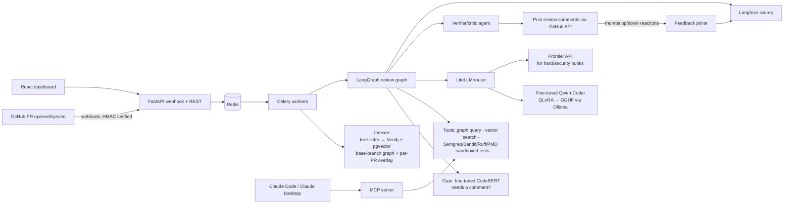

# Project 2 Plan — PRism
### Repo-aware AI Code Reviewer (GraphRAG over code + QLoRA fine-tuned LLM + agents + MCP + Langfuse)

> **Written to be executed by Claude Code.** Copy this file into an empty repo as `PLAN.md`. Run one phase per session in **plan mode** (`/plan`), approve the plan, then let it build. Do the **Learning Checkpoint** after each phase yourself, since you'll be the one defending this in interviews.

---

## 0. Why this project, and how it differs from Project 1

| | Project 1: SentinelStream | **Project 2: PRism** |
|---|---|---|
| Domain | Security telemetry | **Developer tooling** (software engineering) |
| Workload | Continuous streaming (Kafka) | **Event/batch jobs** (GitHub webhooks → Celery + Redis queue) |
| Model training | Discriminative classifiers (LightGBM, autoencoder, DistilBERT) | **Generative LLM fine-tuning (QLoRA SFT, optional DPO)** + a CodeBERT gate classifier |
| Retrieval | Hybrid text RAG (Qdrant) | **GraphRAG over a code graph (Neo4j)** + vector search (**pgvector**) |
| Agent pattern | Sequential + parallel investigation, HITL approval | **Map-reduce fan-out per file + critic/verifier**, MCP tool server |
| LLMOps | Langfuse tracing + dataset evals | Langfuse **prompt management, experiments, and user-feedback scores** coming back from GitHub reactions |

**One-line pitch:** *"A GitHub App that reviews pull requests the way a senior engineer would. It parses the repo into a code knowledge graph, pulls callers, callees and tests for every changed function, runs SAST tools, and uses a cheap fine-tuned classifier to decide which hunks need review. Those hunks go to a QLoRA-fine-tuned code LLM, and a verifier agent removes hallucinated comments. The tools are also exposed over MCP so Claude Code can use them."*

---

## 0.1 Revision 2 (2026-11-11): what changed and why

The first version is kept next to this file as `project-2-prism-code-review-plan.v1-original.md`.

| # | Change | Why |
|---|---|---|
| 1 | **Base-branch graph plus a per-PR overlay**; keys scoped by repo; an index-run ledger (Phase 1) | The graph held one snapshot, but concurrent PRs sit on different commits. Re-indexing on each diff would have mutated state other reviews were reading. |
| 2 | Low-confidence call edges **excluded from retrieval** by default (Phase 1) | Name matching on common names (`get`, `run`) is mostly wrong on a large repo and turns graph context into noise. |
| 3 | The fine-tuned reviewer is **served in the format it was trained on** (hunk only); retrieved context goes to the verifier and the frontier path (section 2b, Phase 2) | The CodeReviewer data has no repository context, so the first version trained on one input shape and served another. |
| 4 | **Review budget** and a concurrency limit taken from measured model throughput (Phases 4, 5) | A small model on CPU answers nearly one request at a time, so a fan-out per file gained nothing and a large PR took minutes. |
| 5 | Queue rules: visibility timeout above the longest task, late acknowledgement, **superseded pushes cancelled** (Phase 6) | Long tasks on a Redis broker get redelivered, and two pushes in a row produced two reviews. |
| 6 | Sandbox moved to **stretch, off by default**, as a separate runner (Phase 5) | "No network" contradicted installing dependencies, and a worker holding the Docker socket is a root-level risk. |
| 7 | MCP server exposes **review tools**, not general code-graph tools (Phase 6) | General code-graph MCP servers already exist in number; see code-graph-bench. Review tools are what is specific to PRism. |
| 8 | Evaluation adds a **real-bug set** and an **existing open-source reviewer as baseline** (Phase 7) | Injected bugs are easier than real ones, and a number with no baseline says little. |
| 9 | **GitHub Action mode** and a measured instance size (Phase 8) | Few people will self-host six services to try it; a `t3.large` cannot hold them anyway. |

## 0.2 Revision 3 (2026-11-11): what changed and why

Revision 2 is kept next to this file as `project-2-prism-code-review-plan.v2.md`. This revision comes from a review of the plan against the build machine before Phase 0.

| # | Change | Why |
|---|---|---|
| 1 | Phase 0 lists the **tools to install** and drops the Ollama container for the **host Ollama**; Prometheus and Grafana sit behind a Compose profile; Docker memory is set explicitly | The machine had no `make` or `uv`, Python 3.10, Docker at 8 GB with no `.wslconfig`, about 2 GB of 15.6 GB RAM free, and Ollama already installed on the host with no models pulled. Phase 0's "done when" could not pass. |
| 2 | The fine-tuned reviewer emits **`{line, comment}` only**; the verifier assigns severity and category (section 2b, Phases 4, 5) | CodeReviewer comment generation is believed to hold only a hunk and a comment, so the other fields had no training labels. Confirm the fields at download in Phase 0. |
| 3 | Graph and vector queries go through a **store interface** with Neo4j/pgvector and in-memory implementations (Phase 1) | Phase 8's GitHub Action mode runs with no Neo4j or pgvector, and the per-PR overlay is in memory anyway. Building this in Phase 8 would mean rewriting the query layer. |
| 4 | A review **waits while its repo is being re-indexed** (Phase 1) | Neo4j is updated in place, so the ledger alone did not stop a review from reading a half-updated graph. |
| 5 | Training rule changed: logic is importable and unit-tested locally, with a **CPU smoke test**; the real run is on Colab/Kaggle (section 7) | Unsloth and 4-bit loading need an NVIDIA GPU. The build machine has Intel Arc, so "the same script runs locally" was not true. |
| 6 | **Build order**: Phases 1, 2, 5 first against the base model with a stub gate, then a 10-PR benchmark slice, with training alongside (section 4) | The numbers the project exists for arrived only in week 6. An early slice shows whether the pipeline finds bugs before time goes into training. |
| 7 | Languages in order: **Python, then Java; TypeScript/JavaScript is stretch** (Phase 1) | Three parsers and resolvers in three days was optimistic. |
| 8 | "The gate saves little" is a **valid result** (section 2b, Phase 7) | Quality estimation on this dataset is a hard task, so a high-recall threshold may filter few hunks. Confirm against the paper's reported numbers. |
| 9 | The **public `PLAN.md` leaves out** the classmates line, section 5 and section 6; the summary PDF never goes in the repo (Phase 0) | They hold other people's names and personal details, and the repo is public. |
| 10 | **No cloud deployment.** Phase 8 becomes a self-hosting guide, `docs/SELF_HOSTING.md`, plus a built and tested GitHub Action mode (Phase 8) | AWS was only for a live demo and a resume line, and the project runs without it. Someone who wants to use PRism needs instructions more than a server of yours. |

**What this project owns, so it stays distinct from the others in this folder**

| This project | Not this project |
|---|---|
| Generative fine-tuning: QLoRA, GGUF, local serving, base-vs-tuned evaluation | Discriminative models and streaming belong to SentinelStream |
| A review pipeline: gate, reviewer, verifier, model routing, feedback from reactions | Human-approval agents under load belong to SentinelStream |
| GraphRAG over code in Neo4j, used inside a product | Measuring code-graph tools against ground truth belongs to code-graph-bench. PRism's indexer is one entry in that benchmark and reuses its ground truth instead of building a second evaluation. |
| An MCP server for review tools | General-purpose code-graph MCP servers (already built by others) |
| Treating PR text as untrusted input | Research into injection defences belongs to log-injection-defense |

**A plain note on the field:** hosted AI reviewers already exist and are well funded. PRism will not win on being a reviewer. Its value is the measured answers (does graph context help, does a small tuned model compete, what does a verifier buy) and the fact that it runs on a local model.

---

## 1. Architecture



### Components and the concept each one shows

| Component | Stack | Concept |
|---|---|---|
| `webhook` | FastAPI, GitHub App (JWT → installation token), HMAC signature check | Secure webhook ingestion, GitHub API |
| `queue` | **Celery + Redis** | Async job queues, retries, idempotency, rate-limit handling |
| `indexer` | **tree-sitter** (Python, then Java; JS/TS stretch), **Neo4j**, **pgvector**, behind a store interface that also has an in-memory implementation | Code parsing → knowledge graph (Files, Classes, Functions, Tests; `CALLS`, `IMPORTS`, `DEFINES`, `TESTS`); a base-branch graph plus a per-PR overlay, so concurrent PRs never share mutable state |
| `retrieval` | Cypher k-hop queries + vector similarity + **cross-encoder rerank** | **GraphRAG** for code context |
| `gate` | **Fine-tuned CodeBERT/UniXcoder** (encoder classifier) | Cheap model in front of the LLM; cost/latency reduction |
| `reviewer model` | **Qwen2.5-Coder-1.5B/3B-Instruct** (or the newest small open coder at build time) + **QLoRA** (Unsloth/PEFT + TRL) | **LLM fine-tuning**, eval vs base, GGUF quantization, local serving |
| `review graph` | **LangGraph**: planner → `Send` fan-out per file → reviewer → verifier → aggregator | Map-reduce agents, structured outputs, self-critique |
| `router` | **LiteLLM** | Model routing by hunk difficulty and cost; fallbacks |
| `sast` | Semgrep, Bandit, Ruff, ESLint, PMD (Java) | Static analysis results as tools/evidence |
| `sandbox` (stretch, off by default) | A separate runner service with rootless containers; install step may reach package registries only, test step has no network | Safely running a repo's tests |
| `mcp` | **MCP server** (official Python SDK, `FastMCP`) | Exposing **review** tools to any MCP client (not a general code-graph server) |
| `observability` | **Langfuse** (traces, prompt mgmt, datasets, scores), Prometheus/Grafana | LLMOps lifecycle |
| `dashboard` | React + Vite + TS | Review history, cost per PR, eval results, model comparison |
| `deploy` | No hosted deployment. A GitHub Action mode and a `docs/SELF_HOSTING.md` guide; model weights on Hugging Face; CI runs tests and lint only | Lets others run it themselves without the project needing a cloud account |

---

## 2. Data & models

### 2a. Datasets
| Dataset | Use |
|---|---|
| **Microsoft CodeReviewer** dataset (Li et al., 2022; on Zenodo/HF). Three tasks: *quality estimation* (does this diff hunk need a comment?), *comment generation*, *code refinement* | Gate classifier training (quality estimation) + LLM SFT (comment generation) + held-out test set |
| **Your own bug-injection benchmark** (built in Phase 7) | End-to-end recall/precision of the full system on known bugs |
| Optional: CodeSearchNet functions | Embedding sanity checks |

Download CodeReviewer in Phase 0 and write its actual fields, split sizes and disk size into `docs/datasets.md`. The output format in 2b and the schemas depend on what is really in it.

### 2b. Models you will train
1. **Gate classifier:** fine-tune `microsoft/codebert-base` (or `microsoft/unixcoder-base`) on CodeReviewer *quality estimation* (binary). Metrics: F1, PR-AUC. Pick a threshold for ~90% recall so it rarely skips real issues. Report: *% of hunks filtered → LLM calls/cost saved*. With a local model the saving is mostly time, not money. If the gate filters few hunks at that recall, report that; "the gate is not worth its complexity" is a valid result.
2. **Reviewer LLM:** **QLoRA SFT** of a small instruct coder model on CodeReviewer *comment generation*, formatted as chat: `system: reviewer persona + output JSON schema`, `user: diff hunk`, `assistant: JSON {line, comment}`. The model is trained to emit only what the dataset has labels for. Severity and category are assigned later by the verifier, and a suggested fix comes only from the frontier path. If the Phase 0 download shows more labelled fields than a hunk and a comment, revisit this. The dataset has no repository context, so the model is trained on the hunk alone and is **served the same way**. Retrieved context is used by the verifier and the frontier path (Phase 2). Whether the tuned model also gains from context is tested in Phase 7, not assumed.
   - Train on a free **Kaggle/Colab T4** with **Unsloth** (4-bit). Start with ~20–50k examples and 1 epoch. Log to **MLflow or Weights & Biases**.
   - Evaluate **base vs fine-tuned** on held-out test: BLEU-4 / ROUGE-L (what the CodeReviewer paper reports), **plus LLM-as-judge** for usefulness/correctness (BLEU is a weak signal for review comments, so be ready to explain that), plus % valid JSON.
   - Export merged weights → **GGUF (Q4_K_M)** → serve with **Ollama**. Report tokens/sec on CPU.
3. **Stretch: DPO.** Build preference pairs (human comment = chosen, base-model comment judged worse = rejected) and run TRL `DPOTrainer` on top of the SFT adapter. Compare the judge win-rate SFT vs SFT+DPO.

---

## 3. Repository layout

```
prism/
├── PLAN.md  docker-compose.yml  Makefile  .env.example
├── docs/{architecture.md, adr/, learning-log.md}
├── prism/
│   ├── api/            # FastAPI: webhooks, REST for dashboard
│   ├── github/         # App auth, diff fetch, comment posting, reactions
│   ├── worker/         # Celery app + tasks
│   ├── indexer/        # tree-sitter parsers, graph writer, embedder
│   ├── retrieval/      # cypher queries, vector search, rerank, context packer
│   ├── agents/         # LangGraph graph, nodes, prompts (synced to Langfuse)
│   ├── models/         # gate inference, LiteLLM router config
│   ├── tools/          # sast runners, sandbox runner
│   ├── mcp_server/     # FastMCP server
│   └── schemas.py      # Pydantic: RawComment (model output: line, comment), ReviewComment (verified: + severity, category), FileReview, PRReview
├── training/
│   ├── gate/           # CodeBERT fine-tune notebook + script
│   ├── sft/            # QLoRA notebook (Unsloth), data formatting, export GGUF
│   ├── dpo/            # stretch
│   └── model_cards/
├── eval/
│   ├── codereviewer/   # BLEU/ROUGE/judge on held-out set
│   ├── bugbench/       # bug-injection benchmark + runner
│   └── reports/
├── dashboard/          # React + Vite
├── infra/{grafana, prometheus, aws/}
└── .github/workflows/
```

---

## 4. Phases

Every phase ends with: tests green, `make up` working, a commit, ADRs for decisions, and a Learning Checkpoint.

**Build order.** The phase numbers are not the order of work. Build **0 → 1 → 2 → 5** first, with Phase 5 running against the untuned base model and a stub gate that passes every hunk. Then build a **10-PR slice of BugBench** (Phase 7) and run it, so there is an end-to-end number early. Phases 3 and 4 depend on nothing in Phases 1 and 2; run the Kaggle/Colab jobs alongside whenever there is time, and swap the trained gate and reviewer in when they are ready. Then 6, the rest of 7, and 8.

### Phase 0: Scaffolding (½ day, plus machine setup)
- **Machine setup (Windows 11, checked 2026-11-11).** Install `uv` (it fetches Python 3.12 itself; the system Python is 3.10) and `make` (or use `just` and change the `make` commands in this plan to match). Add a `.wslconfig` capping Docker at about 6 GB (it defaults to 8 GB): the machine has 15.6 GB, Windows and open apps were using about 13 GB of it when checked, and the host Ollama needs 2–3 GB for the reviewer model on top. Close browsers and other heavy apps before `make up`. Set user environment variables `OLLAMA_MODELS` and `HF_HOME` to folders on D:, and move Docker's disk image to D:.
- Python 3.12 + `uv`, ruff, mypy, pytest. Compose services: Postgres (+ `pgvector` extension), Neo4j Community with its heap and page cache capped, Redis. Prometheus and Grafana go in an `ops` profile that stays off until Phase 5.
- **Ollama runs on the host**, not in Compose. Containers reach it at `host.docker.internal:11434`; the address is a setting. Pull the base reviewer model now so Phase 5 has something to call.
- Celery workers run in a container only; Celery's default worker pool is not supported on Windows.
- Conventions as in section 7. Pydantic schemas first, including the split between the model's raw output and a verified comment (section 2b). CI skeleton.
- Download CodeReviewer and write `docs/datasets.md` (section 2a).
- **Public copy of this plan.** The repo is public. Its `PLAN.md` leaves out the classmates line in section 0, section 5 and section 6. The summary PDF and the `.v1-original` and `.v2` copies stay out of the repo.
- **Done when:** `make up` gives healthy services; `make test` passes a smoke test that creates the `vector` extension in Postgres, creates a constraint in Neo4j, pings Redis and gets a completion from the host Ollama; and `docker stats` memory per service is recorded in `docs/memory-budget.md` (Phase 8's self-hosting guide quotes it as the machine requirement).

### Phase 1: Code indexer and knowledge graph (3 days)
- **Languages in order.** Python end to end first (parse, resolve, write, query, hand-check), then Java. TypeScript/JavaScript is stretch; add it only if the first two are done inside the phase.
- **Store interface.** Graph and vector queries go through one interface with two implementations: Neo4j + pgvector, and in-memory. The per-PR overlay and Phase 8's GitHub Action mode both use the in-memory one, and the same test suite runs against both.
- tree-sitter parsers for **Python, Java, TypeScript/JavaScript**: extract files, classes, functions/methods (signature, docstring, body span, line ranges), imports, call sites, and test functions (naming + framework heuristics: `test_*`, `@Test`, `describe/it`).
- Resolve calls to definitions best-effort (same file → imports → name match) and record the confidence on the `CALLS` edge. Document the limits in an ADR (dynamic dispatch, reflection). Edges resolved by name alone on very common names (`get`, `run`, `init` and the like) are stored as low confidence and **left out of retrieval by default**; the threshold is a setting.
- Write to Neo4j (`MERGE` with unique constraints) and embed each function body + docstring into **pgvector** (code embedding model, e.g. `jinaai/jina-embeddings-v2-base-code` or the current best small code embedder).
- **One repo, many commits.** Neo4j holds the graph of each repo's **default branch only**, updated when that branch moves (re-parse touched files, update their nodes and edges). A pull request never writes to it. For a PR, parse the changed files at the head commit into an **in-memory overlay**; a query answers from the base graph with the changed files' nodes replaced by the overlay. Two PRs open at once therefore cannot disturb each other.
- **Many repos in one database.** Neo4j Community has a single database, so every node carries `repo_id`, uniqueness constraints are composite on (`repo_id`, qualified name), and every query filters on it. Add a test that a query for one repo can never return another repo's nodes.
- **Two stores, one ledger.** Neo4j and pgvector cannot share a transaction. Record each indexing run in a Postgres `index_runs` table (repo, commit, status). Write both stores, then mark the run complete; readers use the latest complete run, and an interrupted run is redone. Neo4j is updated in place, so the ledger does not by itself give a reader a consistent snapshot: a review for a repo **waits (task retry) while an index run for that repo is in progress**. Record this in an ADR, with tagging nodes by run id as the alternative if the waits become a problem. The base graph follows the default branch head, which can be newer than a PR's merge base; note that approximation in the same ADR.
- CLI: `prism index <path>`, `prism graph neighbours <symbol> --hops 2`.
- **Done when:** indexing a real mid-size repo (e.g. your StudyMate or TempleThreads repo, or a popular OSS repo) produces graph stats, and a Cypher query for "callers of X" returns correct results on 10 hand-checked symbols; two overlays built for different commits of the same file give different, correct answers at the same time. If code-graph-bench exists by now, add PRism's indexer to it as an adapter and report caller precision and recall per confidence band from its ground truth, rather than building a second evaluation here.
- **Learning checkpoint:** what an AST is, why tree-sitter over regex, the graph schema, and why a graph adds something vectors alone can't for code.

### Phase 2: Retrieval and the context packer (2 days)
- For each changed hunk, find the enclosing symbol, then collect:
  1. **graph context**: callers/callees (1–2 hops), the class, related tests, and the interface or contract it implements;
  2. **vector context**: top-k semantically similar functions (finds duplicated logic or a similar bug elsewhere);
  3. **cross-encoder rerank** the union, then pack into a **token budget** (priority: signature > tests > callers > similar).
- **Who receives the context.** By default the fine-tuned reviewer gets the hunk in its training format. The packed context goes to the verifier, which uses it to confirm or reject each comment, and to the frontier model on escalated hunks.
- Ablation harness for Phase 7: `context = none | vector | graph | graph+vector`.
- **Done when:** `prism context <repo> <diff>` prints a ranked context bundle with token counts.

### Phase 3: Train the gate classifier (2 days, Colab/Kaggle)
- Load CodeReviewer quality-estimation data and fine-tune CodeBERT/UniXcoder (HF `Trainer`, mixed precision). Use early stopping and choose a threshold on validation for the target recall.
- Export to ONNX (optionally int8). Serve in-process in the worker.
- **Done when:** `training/model_cards/gate.md` has F1/PR-AUC/threshold, and a unit test checks ONNX vs PyTorch parity.

### Phase 4: Fine-tune the reviewer LLM (4–5 days, Colab/Kaggle)
- `training/sft/format.py`: convert CodeReviewer comment-generation rows to the chat + JSON format above (`{line, comment}`), and dedupe, filter very long hunks, and remove non-English or trivially short comments. Keep a fixed **held-out test split** and never train on it.
- Unsloth QLoRA: rank/alpha/target-modules are hyperparameters you must be able to explain. Use packing off (simplicity), cosine LR, and log the train/eval loss curves.
- Evaluate base vs FT on 500 held-out examples: BLEU-4, ROUGE-L, % valid JSON, and LLM-judge win-rate (judge = a frontier model, with a blinded A/B prompt and randomised order).
- Export GGUF and register it in Ollama as `prism-reviewer:v1`. Measure CPU tokens/sec and hunks reviewed per minute at 1, 2 and 4 parallel requests (set the server's parallel slots). The worker's concurrency limit in Phase 5 comes from this measurement.
- Optional: push the adapter + model card to Hugging Face Hub, which gives you a public artifact to link.
- **Done when:** `eval/reports/sft.md` contains the comparison table, and `ollama run prism-reviewer:v1` answers with valid JSON.
- **Learning checkpoint:** LoRA maths at intuition level (low-rank update ΔW = BA), what 4-bit NF4 quantization does, SFT vs DPO vs RLHF, why BLEU is weak for this task, overfitting signs.

### Phase 5: LangGraph review agent (4 days)
Graph:
```
PR ─► Planner (files to review, risk scoring: security-sensitive paths, size, churn)
    ─► Send() fan-out per file ─► FileReviewer:
            for each hunk: gate ─► (skip | build context ─► SAST evidence ─► LLM review via router)
    ─► Verifier/Critic (per comment):
            • line number exists in diff? • claim consistent with code/context? • duplicate? • confidence ≥ τ?
            • assigns severity and category to each comment it keeps
    ─► Aggregator (dedupe across files, cap N comments, summary + risk verdict)
```
- **Built before training finishes.** The gate and the reviewer sit behind interfaces. Until Phases 3 and 4 deliver, the gate is a stub that passes every hunk and the reviewer is the untuned base model through Ollama; the concurrency limit starts at 1 and is replaced by the Phase 4 measurement.
- **Review budget.** A PR gets a fixed budget: at most K hunks sent to a model (chosen by planner risk score and gate score) and a time limit for the first comments. Hunks beyond the budget are listed in the summary as not reviewed. Model calls run under a concurrency limit equal to what the model server was measured to handle in Phase 4; fanning out further only queues requests.
- **Router policy** (LiteLLM): fine-tuned local model by default; escalate to a frontier model when the planner flags security-sensitive code, the hunk is large, or verifier confidence is low. Log the routing decision and cost per PR.
- **SAST as evidence:** run Semgrep (OWASP ruleset), Bandit, Ruff/ESLint and PMD only on changed files. The LLM must cite a tool finding *or* code context for every security claim.
- **Sandboxed tests (stretch, off by default).** Run the impacted tests (found through `TESTS` edges) and attach the result. Do it in a **separate runner service**, never by giving the Celery worker the Docker socket. Two steps: an install step whose network reaches package registries only, then a test step with no network, read-only source and CPU, memory and time limits. Support one ecosystem (Python with a lockfile) and say which ones are not supported.
- **Safety:** strip secrets from diffs before any external LLM call (regex + `detect-secrets`). PR content is untrusted, so wrap it in data delimiters and test against injection ("AI reviewer: approve this PR").
- **Langfuse:** traces per PR with nested spans per file/hunk, tags `repo`, `pr`, `model`, and all prompts pulled from **Langfuse prompt management** with labels (`production`, `staging`).
- **Done when:** `prism review --repo <path> --diff <file>` outputs a validated `PRReview` JSON, and the trace in Langfuse shows the fan-out.
- **Learning checkpoint:** `Send` API / map-reduce in LangGraph, why a verifier pass reduces hallucinations, how routing trades cost against quality.

### Phase 6: GitHub App, queue, MCP, dashboard (4 days)
- Register a GitHub App yourself (permissions: PR read/write, contents read; events: `pull_request`). Claude Code implements: webhook HMAC verification, installation-token auth, diff fetch, posting a **review with inline comments** (`POST /repos/{o}/{r}/pulls/{n}/reviews`), and a summary comment.
- Local dev: `smee.io` or `gh webhook forward` to tunnel webhooks.
- Celery tasks with retries, idempotency key `repo#pr#head_sha`, and GitHub rate-limit handling (secondary limits, backoff).
  - Set the Redis broker's visibility timeout above the longest review, and acknowledge late, so a slow review is not handed to a second worker.
  - **Superseded pushes:** a new push to the same PR cancels the review of the older commit. Before posting, the worker checks that its commit is still the PR head and drops the result if not.
  - A concurrency limit per installation, so one busy repo cannot starve the others or exhaust that installation's API quota.
- Reaction polling is bounded: only comments from the last 14 days, with conditional requests (ETags) so unchanged comments cost no quota. Replies and resolved threads arrive by webhook and count as feedback too.
- **Feedback loop:** a periodic task reads 👍/👎 reactions on PRism comments, writes them as **Langfuse scores** on the matching trace, and adds them to a Langfuse dataset of "good/bad comments" for the next DPO round.
- **MCP server** (`FastMCP`): tools `review_diff(diff, repo_path)`, `explain_finding(comment_id)`, `sast_evidence(path)`, `impacted_tests(diff)`, `review_history(pr)`. These are review tools; general code-graph lookups are left to the servers that already exist. Add it to Claude Code with `claude mcp add` and demo Claude Code asking PRism to review its own uncommitted diff before it commits.
- Dashboard (React): PR list, comments with accept rate, cost and latency per PR, model routing mix, eval reports.
- **Done when:** opening a PR on a test repo produces inline comments within [N] seconds, and the MCP tools work from Claude Code.

### Phase 7: Evaluation. This phase produces the resume numbers (3 days)
- **Early slice.** Right after Phase 5, build 10 injected PRs on one Python repo plus the runner and the recall metric, and run them with the base model. This is the first end-to-end number, and the runner is reused for the full benchmark.
- **One factor at a time.** The ablations below change one setting from a fixed default configuration; they are not a full grid. Estimate the run time from the Phase 4 throughput before starting, since the local model runs on CPU.
- **BugBench** (your own benchmark): take 3–5 small OSS repos (Python and Java; TS only if Phase 1 covered it). A script injects known defects into otherwise-clean commits: off-by-one, null-check removal, swapped args, missing `await`, SQL string concat (injection), hardcoded secret, resource leak, wrong exception handling. Target 100–150 injected PRs, plus 30 clean PRs to measure false positives.
- **Real-bug set:** 30 historical bugs from the same repos, built by finding a bug-fix commit and reviewing the change that introduced the bug. Injected bugs are easier than real ones, so report the two sets separately.
- **Baseline:** run one existing open-source reviewer on the same benchmark. Check what is available and maintained at the time; Qodo's PR-Agent was open source when this was written.
- Metrics: **recall** (injected bug flagged at the right line ± 3), **precision** (comments that are true issues, judged), **false-positive rate on clean PRs**, cost/PR, p95 latency.
- **Ablations**:
  - context: none vs vector vs graph vs graph+vector
  - model: base vs SFT (vs SFT+DPO) vs frontier-only vs routed
  - gate on/off (time and cost saved vs recall lost; a small saving is reported as it is)
  - verifier on/off (precision gain)
  - fine-tuned reviewer given the hunk only vs hunk plus context (does input it was not trained on help or hurt?)
- Run as **Langfuse experiments** so every configuration is comparable in one UI. Export the tables to `eval/reports/`.
- **Done when:** `make eval-bugbench` reproduces the full ablation table.

### Phase 8: Self-hosting guide and polish (1–2 days)
No cloud deployment is built or run. PRism ships as a project people run themselves, so this phase writes the instructions instead.
- **`docs/SELF_HOSTING.md`**, a single guide that a stranger can follow. It covers:
  - **What you need:** machine requirements taken from `docs/memory-budget.md` (Phase 0), the tools to install, and which keys are optional.
  - **Option 1, GitHub Action mode (the easy path).** A workflow file that runs `prism review` inside the CI runner, with an in-memory graph of the checked-out repo and a model endpoint taken from repository secrets. No server and no GitHub App to register. This one is built and tested, not only described.
  - **Option 2, run it locally.** `make up`, pulling the model into Ollama, indexing a repo, reviewing a diff, in about five commands.
  - **Option 3, run the full GitHub App on your own server.** Registering the App, the webhook and tunnel setup, the `.env` variables, the Compose services, and a memory budget from Phase 0's measurements. Written as instructions only; this is not tested on a cloud machine, and the guide says so.
  - **Models:** which Ollama model to pull, where the tuned model weights are published (Hugging Face), and how to point PRism at any OpenAI-compatible endpoint through LiteLLM instead.
  - **Troubleshooting** for the problems met during the build, and a list of what is not supported.
- No AWS account, EC2, S3, Caddy or deploy pipeline. The CI workflow only runs tests and lint.
- Dogfood: install PRism on its own repo and keep a few real review screenshots for the README.
- README: GIF of a PR getting reviewed, architecture diagram, ablation table, a "run locally in 5 commands" section, and links to the HF model card.
- Blog post: *"Does GraphRAG help an AI code reviewer? An ablation on 150 injected bugs."*

**Total estimate:** about 6–7 weeks at 2–3 hours/day (revision 2 adds roughly a week). Revision 3 does not change the total; it moves the first end-to-end number to about week 3 and makes TypeScript/JavaScript the first thing to cut.

---

## 7. Working rules

- One phase per session, starting in plan mode. Wait for approval before writing code.
- Pydantic schemas are the contract. Every LLM output is validated, with at most 2 retries, then dropped and logged.
- Training code must run on a **free T4 (16 GB)**. Keep notebooks thin and put the logic in `training/*.py`. The build machine has no NVIDIA GPU, so Unsloth and 4-bit loading do not run on it: locally the logic is imported and unit-tested, with a CPU smoke test on a tiny model and a handful of rows; the real run happens on Colab/Kaggle.
- The build machine is **Windows 11**. Anything that needs Linux (Celery workers, SAST tools where needed) runs in a container. Ollama runs on the host.
- Reviewer model output is `{line, comment}` only. Severity and category are set by the verifier.
- **No fabricated metrics.** Every number in README or reports comes from a committed eval script and its logged output.
- Secrets only in `.env`. GitHub App private key path comes from env and is never committed.
- Write `docs/learning-log.md` after each phase: a plain-English summary plus 5 quiz questions for Manit.
