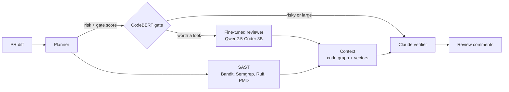

# PRism

PRism is a code reviewer I built that understands the repository a pull request lands in. It
parses the repo into a code graph, pulls the callers, callees and tests of every changed
function, reviews each hunk with a small model I fine-tuned to run on a laptop CPU, runs static
analysis next to it, and has Claude check every comment against the code before anything is
posted. It runs from the command line, inside Claude Code as an MCP server, or as a GitHub App.

## Results

I measured PRism on BugBench, a benchmark I built from 198 real pull requests in four
open-source projects (TinyDB, aiosqlite, sqlite-utils and jsoup): 139 with a planted bug that a
test catches, 30 that introduced a real bug fixed later, and 29 clean ones.

| | PRism | PRism, whole PR to Claude |
|---|---|---|
| Planted bugs found | 115/139 (83%) | 124/139 (89%) |
| Real bugs found | 17/30 | 18/30 |
| Clean PRs with any comment | 0/29 | 1/29 |
| Comments per buggy PR | 0.99 | 1.02 |

A bug is found when a posted comment sits within 3 lines of it. Every comment PRism posted was
also judged: **162 of 167 (97%) are true, useful review comments**, and 117 of the planted bugs
are named in a comment, wherever it is placed. Of PRism's planted-bug finds, 23 came straight
from the fine-tuned local model and the rest from Claude after the local pass and routing.

The confidence threshold decides which of Claude's comments get posted. At the default 0.6 PRism
leaves every clean PR alone; lowering it to 0.4 finds 118 planted and 19 real bugs at the cost
of one comment on a clean PR, so the default stays where it is.

Against PR-Agent with the same model behind both (on the first 83 PRs), PR-Agent found a few
more bugs, while PRism posted half as many comments, none on a clean PR, and sent the model
about a quarter less input. The ablations then showed where the gap came from: replacing my
local reviewer with Claude changed little, and showing Claude the whole pull request at once
closed most of it. The full tables are in [`eval/reports`](eval/reports) and the reasoning in
ADRs 0021 to 0026.


## How a review works



1. **Plan.** The diff is split into hunks, and each file gets a risk score (churn, security
   paths, size). A CodeBERT classifier, exported to ONNX, scores each hunk; the review budget
   goes to the hunks that matter most.
2. **Review.** A Qwen2.5-Coder 3B model I fine-tuned with QLoRA writes one comment per hunk,
   locally through Ollama. Security-sensitive or very large hunks skip it and go straight to
   Claude.
3. **Static analysis.** Bandit, Semgrep, Ruff and PMD run on the changed files at the same time.
4. **Context.** For every hunk with something to check, PRism retrieves related code from a
   Neo4j code graph (callers, callees, tests, the enclosing class) and from pgvector embeddings,
   reranks it and packs it into a token budget.
5. **Verify.** Claude judges each comment against the hunk and its context: it keeps, drops,
   relabels or moves it, and flags hunks that hide a bug the comment missed for a review of
   their own. A comment is posted only above a confidence threshold, and a security comment
   only with evidence. Secrets are redacted before anything leaves the machine, and PR text is
   treated as untrusted.

Every review is traced in a self-hosted Langfuse, and prompts are served from it.

## Tech stack

- **Language and tooling:** Python 3.12, `uv`, Typer, Pydantic, Ruff, mypy, pytest, Docker
  Compose, GitHub Actions.
- **Code graph and retrieval:** tree-sitter (Python and Java), Neo4j, Postgres with pgvector,
  `nomic-embed-text` embeddings, a MiniLM cross-encoder reranker.
- **Models:** a fine-tuned Qwen2.5-Coder 3B served by Ollama as a Q4_K_M GGUF, a CodeBERT gate
  classifier on ONNX Runtime, and Claude as verifier and frontier reviewer.
- **Agent:** LangGraph (fan-out per file, a shared concurrency limit, routing and a second
  verification round).
- **Static analysis:** Bandit, Semgrep, Ruff and PMD.
- **Product:** a GitHub App on FastAPI with a Celery and Redis queue, an MCP server for Claude
  Code, comment feedback into Langfuse, and a React and TypeScript dashboard built with Vite.
- **Observability:** self-hosted Langfuse for traces, prompts, datasets and experiments.

## How I trained the models

Both models were trained on free Kaggle T4 GPUs, from thin notebooks that clone the repo and run
the code in `training/`. Runs were tracked in Weights & Biases.

- **Gate classifier.** CodeBERT fine-tuned with Hugging Face Transformers on the CodeReviewer
  quality-estimation data (does this hunk get a review comment?), threshold set for high recall
  on the validation split, exported to ONNX so it runs on a CPU in milliseconds
  ([model card](training/model_cards/gate.md)).
- **Reviewer.** Qwen2.5-Coder-3B-Instruct fine-tuned with QLoRA through Unsloth on CodeReviewer
  comment generation, with the data filtered to specific, human-written comments. The adapter is
  merged and quantized to a GGUF for Ollama. Against the base model on 500 held-out hunks it
  writes shorter, more specific comments and almost always valid JSON
  ([results](eval/reports/sft.md), [model card](training/model_cards/reviewer.md)).

## Run it locally

You need Docker, [`uv`](https://docs.astral.sh/uv/), `make` and [Ollama](https://ollama.com).

```bash
ollama pull qwen2.5-coder:3b
ollama pull nomic-embed-text
make sync && make up
uv sync --group sast
uv run prism review --repo path/to/repo --diff change.diff --store memory --mode graph
```

The fine-tuned reviewer's weights are not published (the base model's licence is
non-commercial), so set `PRISM_REVIEWER_MODEL=qwen2.5-coder:3b` in `.env`; the base model works
as the first-pass reviewer.

Without an Anthropic API key the verifier is a handoff: the first run stops with exit code 2
and writes the requests and a rubric into the work directory, a Claude session answers them, and
the same command again prints the review. With `ANTHROPIC_API_KEY` set,
`PRISM_VERIFIER=api` (and `uv sync --group frontier`) does it in one run. `--verifier rules`
skips Claude and keeps only the deterministic checks.

More commands:

```bash
uv run prism index path/to/repo                 # code graph in Neo4j, embeddings in pgvector
uv run prism graph callers Cart.add             # also callees, tests, neighbours
uv run prism context path/to/repo change.diff --mode graph --render   # the context for a diff
make test                                       # everything; `make unit` needs no services
```

## Use it from Claude Code

```bash
uv sync --group mcp --group sast
claude mcp add prism -- uv run --directory /path/to/prism --group mcp --group sast prism mcp
```

Then ask Claude Code to review your uncommitted changes with PRism. `review_diff` reviews
`git diff HEAD`, and when it needs verification Claude Code answers the requests with
`submit_answers` and asks again. `explain_finding`, `sast_evidence`, `impacted_tests`,
`review_history` and `pending_reviews` cover the rest.

## Run it as a GitHub App

Register an App (pull requests read and write, contents read-only, the pull request event),
install it on a repository, and put its id, private key path and webhook secret in `.env`
(see `.env.example`). Then:

```bash
uv sync --group app --group sast --group mcp
uv run prism app serve --port 8080 --poll
```

Reviews are held until their verification is answered, then posted with inline comments.
`PRISM_APP_QUEUE=celery` runs reviews on a Celery worker (`prism app worker`, `prism app beat`).
Reactions and replies on PRism's comments feed back into Langfuse as scores. The dashboard
(`cd dashboard && npm ci && npm run build`, then `uv run prism dashboard`) shows reviews,
comments posted and dropped with the verifier's reasons, routing, and the eval reports.

## BugBench

`bugbench/configs.toml` lists the configurations, and one command runs them, judges the
comments, sweeps the confidence threshold and writes [`eval/reports/bugbench.md`](eval/reports/bugbench.md):

```bash
export PRISM_BENCH_ROOT=/path/outside/the/repo   # clones, worktrees, test environments, runs
make eval-bugbench
```

The run stops with exit code 2 while Claude's answers are missing and puts every open request
in one handoff folder with a README; answer it (a Claude session or subagents) and run it again.
Answers are cached, so each pass only reviews what is still waiting. `prism bench generate`
grows the planted cases (a mutation is kept only if the repo's tests catch it), `prism bench
real` lists real-bug candidates, and `prism bench experiments` replays finished runs into
Langfuse as experiments.

## Design notes

Every design decision has a short record in [`docs/adr`](docs/adr): the comment schemas, call
resolution, retrieval and packing, the gate, fine-tuning, the review graph, the verifier,
routing and redaction, tracing, the GitHub App, BugBench and each ablation.

## Built with

I built PRism with the assistance of Claude Code.

Licensed under Apache 2.0.
