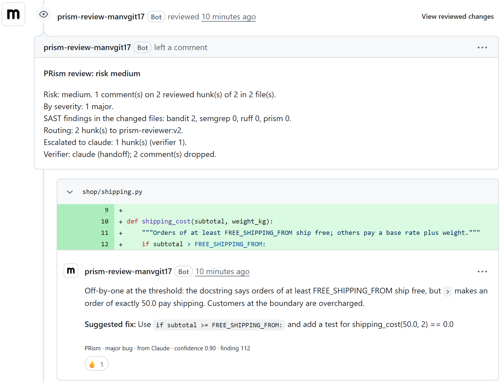
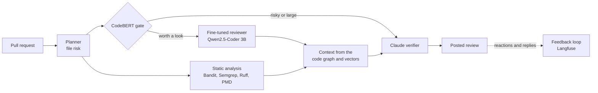
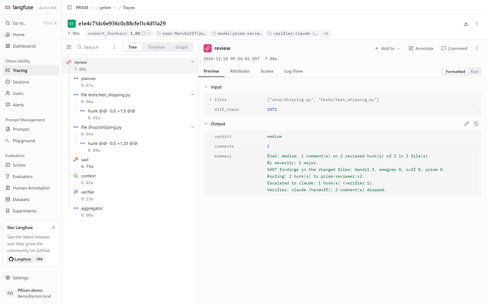
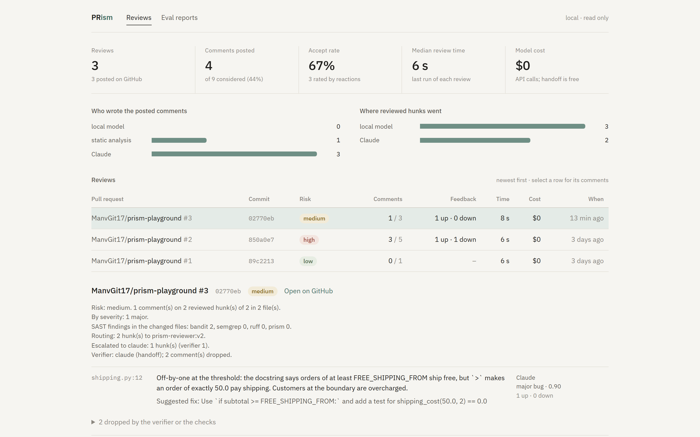

# PRism

**A code reviewer that understands your repository, runs on a laptop, and only speaks when it
has something worth saying.**



## The problem

Code review is where bugs are cheapest to catch, and it is the step teams skimp on first.
Reviewers are busy, pull requests are large, and the bug is rarely in the line that changed: it
is in how that line meets a caller, a contract or a test somewhere else in the repository.

AI reviewers promise to help, but most of them fall short in one of three ways:

- **They only see the diff.** A model that reads a hunk in isolation cannot know that the
  function it changed is called with `None` from three places.
- **They are noisy.** Comment on everything, and people stop reading. A reviewer that flags
  style nits on a clean pull request trains its users to ignore it.
- **They are expensive and opaque.** Every hunk goes to a large hosted model, nobody can see
  why a comment was made, and there is no way to learn from what developers accepted or
  ignored.

## What PRism does about it

PRism reviews a pull request the way a careful senior engineer would: it reads the change in
the context of the code around it, lets a cheap model do the first pass, and only posts what a
stronger model has checked.

- **It knows the repository.** PRism parses the code into a graph (functions, classes, calls,
  tests) and gives every changed hunk its callers, callees and tests as context.
- **It is cheap where it can be.** A small classifier decides which hunks deserve attention,
  and a 3B model I fine-tuned for code review writes the first comments, locally, on a CPU.
- **It is careful where it must be.** Claude verifies every comment against the code before it
  is posted, reviews risky hunks itself, and flags code that hides a bug the first pass missed.
  Security comments need evidence. Secrets are redacted before anything leaves the machine.
- **It is quiet.** On 29 clean pull requests, PRism posted nothing at all.
- **It is observable and it learns.** Every review is traced. Reactions and replies on its
  comments flow back as scores and as training data for the next model.

## Proof

I built a benchmark, BugBench, from 198 real pull requests in four open-source projects
(TinyDB, aiosqlite, sqlite-utils and jsoup): 139 with a planted bug that a test catches, 30 that
introduced a real bug fixed later, and 29 clean ones.

| | PRism | PRism, whole PR to Claude |
|---|---|---|
| Planted bugs found | **115/139 (83%)** | **124/139 (89%)** |
| Real bugs found | 17/30 | 18/30 |
| Clean PRs with any comment | **0/29** | 1/29 |
| Comments per buggy PR | 0.99 | 1.02 |

- **97% of PRism's comments are true, useful review comments** (162 of 167, judged one by one).
- **About one comment per pull request**, almost always on the bug.
- On the first 83 pull requests, compared with PR-Agent using the same model, PRism posted half
  as many comments, none on a clean PR, and sent the model about a quarter less input, while
  PR-Agent found a few more bugs. Ablations then showed where the difference comes from and how
  much of it closes. The full story is in [the evaluation](docs/evaluation/bugbench.md).

## How it works



Every review is traced in a self-hosted Langfuse: each step, each model call, the prompt
version, and later the feedback on each comment.



The dashboard shows what PRism did across reviews: comments posted and dropped with the
verifier's reasons, who wrote each comment, and how developers reacted.



## Ways to use it

- **Command line:** `prism review` on any diff.
- **Inside Claude Code:** an MCP server with review tools, where Claude Code is the verifier.
- **As a GitHub App:** reviews every pull request, holds a review until it is verified, posts
  inline comments, and collects feedback from reactions.

## Get started

You need Python 3.12 with [`uv`](https://docs.astral.sh/uv/) and [Ollama](https://ollama.com).
Docker is optional.

```bash
git clone https://github.com/ManvGit17/prism.git && cd prism
uv sync --group sast && cp .env.example .env
ollama pull qwen2.5-coder:3b
uv run prism review --repo path/to/repo --diff change.diff --store memory --mode graph
```

The [Quickstart](docs/getting-started/quickstart.md) walks through a full review, including
how Claude verifies it. The full documentation (concepts, guides, reference, operations and the
design decisions behind each part) is in [`docs/`](docs/index.md); run `make docs` to browse it
as a site.

## Models

Both models are published on Hugging Face:

- [`Maverick0824/prism-reviewer-3b`](https://huggingface.co/Maverick0824/prism-reviewer-3b):
  Qwen2.5-Coder-3B-Instruct fine-tuned with QLoRA on CodeReviewer comment generation, as a
  GGUF for Ollama plus the LoRA adapter. Built with Qwen; Qwen Research License,
  non-commercial use.
- [`Maverick0824/prism-gate`](https://huggingface.co/Maverick0824/prism-gate): CodeBERT
  fine-tuned to predict which hunks need a comment, exported to ONNX.

Both were trained on a free Kaggle T4 from the code in [`training/`](training/README.md).

## Tech stack

| Area | Tools |
|---|---|
| Language and tooling | Python 3.12, uv, Typer, Pydantic, Ruff, mypy, pytest, Docker Compose, GitHub Actions |
| Code graph and retrieval | tree-sitter (Python, Java), Neo4j, Postgres with pgvector, nomic-embed-text, a MiniLM cross-encoder reranker |
| Models | Qwen2.5-Coder 3B (QLoRA, Unsloth, GGUF, Ollama), CodeBERT (Transformers, ONNX Runtime), Claude |
| Agent | LangGraph |
| Static analysis | Bandit, Semgrep, Ruff, PMD |
| Product | GitHub App on FastAPI, Celery and Redis, MCP server, React and TypeScript dashboard (Vite) |
| Observability and evaluation | Langfuse (traces, prompts, scores, datasets, experiments), BugBench |
| Training | Kaggle T4 GPUs, Hugging Face Transformers, PEFT, Unsloth, Weights & Biases |

## Future scope

- **Learn from every review.** The feedback loop already exports preference pairs; a DPO round
  on accepted versus ignored comments would tune the reviewer to what a team actually values,
  and per-repository thresholds would follow from the feedback report.
- **More languages.** The indexer is built on tree-sitter, so TypeScript, Go and Rust are a
  grammar and a resolver away, which covers most of today's pull requests.
- **Review the whole change, cheaply.** BugBench showed that showing Claude the whole pull
  request finds the most bugs; splitting large PRs by file and caching per-file context would
  make that the default without growing the cost.
- **Cross-file impact analysis.** The code graph already knows callers and tests; surfacing
  which call sites and tests a change affects, next to each comment, would make reviews faster
  to act on.
- **Bring your own model.** Any OpenAI-compatible endpoint for the first pass and any frontier
  model for verification, so teams can keep code on their own infrastructure.
- **Run it in CI.** A GitHub Action mode that reviews in the CI runner with an in-memory graph,
  for teams that do not want to run an App.
- **Security review as a first-class mode.** Taint tracking through the code graph, combined
  with the static-analysis evidence PRism already collects, for injection and secret-handling
  bugs.

## Built with

I built PRism with the assistance of Claude Code.

Licensed under Apache 2.0. The fine-tuned reviewer weights are under the Qwen Research License.
