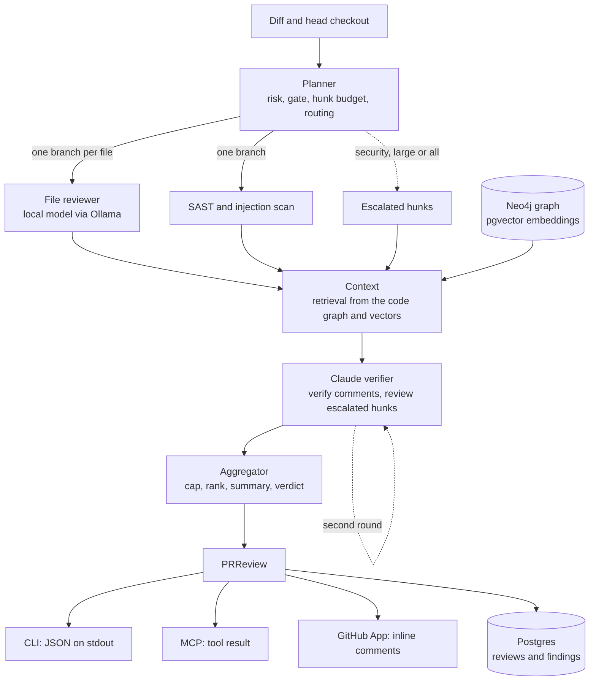
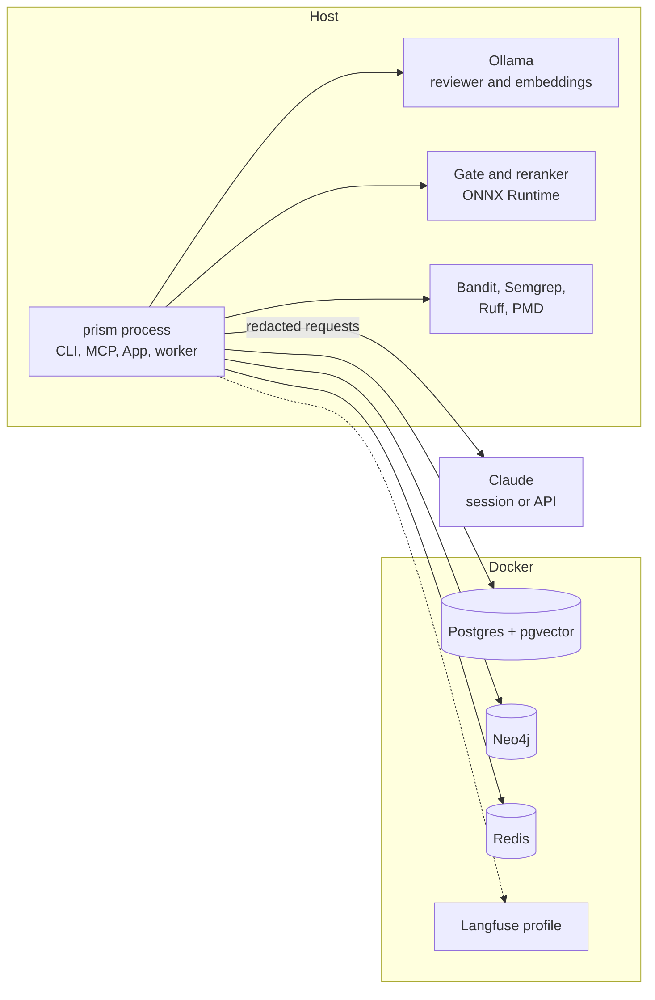

# Architecture

This page names PRism's components, follows one review through them, and says what runs on your
machine, what runs in Docker and what runs in Claude. It is for anyone who wants the whole
picture before reading the pages on each part.

## Components

| Component | What it does | Code |
|---|---|---|
| Diff parser and planner | Splits the diff into hunks, scores file risk, applies the gate and the hunk budget | `prism/retrieval/diff.py`, `prism/review/plan.py` |
| Gate | A CodeBERT classifier (ONNX) that says whether a hunk is worth a model call | `prism/models/gate.py` |
| Local reviewer | A Qwen2.5-Coder 3B model served by Ollama; writes one comment per hunk | `prism/review/reviewer_client.py`, `prism/models/reviewer.py` |
| Static analysis | Bandit, Semgrep, Ruff and PMD on the changed files, plus the prompt-injection scan | `prism/review/sast.py`, `prism/review/injection.py` |
| Indexer | Parses the repository with tree-sitter into a graph of files, classes and functions, and embeds functions | `prism/indexer/` |
| Stores | Neo4j for the graph, Postgres with pgvector for embeddings and the index ledger | `prism/store/` |
| Retrieval | Finds callers, callees, tests and similar code for a hunk, reranks it and packs it into a token budget | `prism/retrieval/` |
| Router | Decides which hunks skip the local model and go straight to Claude | `prism/review/router.py` |
| Claude verifier | Judges each comment against the hunk and its context, and reviews the hunks that were escalated | `prism/review/handoff.py`, `prism/review/frontier_api.py` |
| Aggregator | Caps and ranks the kept comments, writes the summary and the risk verdict | `prism/review/aggregate.py` |
| Review service | One function that builds all of the above from the settings; the CLI, the MCP server and the GitHub App all call it | `prism/review/service.py` |
| Front ends | `prism review` (CLI), `prism mcp` (MCP server), `prism app` (GitHub App) | `prism/cli.py`, `prism/mcp_server.py`, `prism/github/` |
| Observability | Langfuse traces, prompts, feedback scores and experiments | `prism/observability/` |

The review itself is a LangGraph graph. The pieces that are not part of the graph (indexing, the
stores, the front ends) exist to feed it or to carry its result.

## How a review flows

1. The front end gives the review service a diff and a checkout of the head commit.
2. The planner scores each file's risk, runs the gate on every hunk, keeps the best hunks within
   the budget and decides which ones go to Claude directly.
3. For each file, a reviewer branch calls the local model on the hunks that stay local. In
   parallel, one branch runs the static analysis tools on the changed files. All model calls
   share one concurrency limit.
4. The context step ties tool findings to hunks, turns the stronger ones into comments of their
   own, and retrieves code from the graph and the vectors for every hunk that has something to
   check.
5. The verifier applies the deterministic checks, then asks Claude to judge each comment and to
   review the escalated hunks. If a verdict says a hunk hides a bug the comment missed, that hunk
   gets a second round.
6. The aggregator removes duplicates, ranks the comments, applies the comment cap and computes the
   risk verdict from the kept comments.
7. The service stores the review with every decision (kept and dropped) and returns it. The front
   end prints it, hands it to the MCP client, or posts it to GitHub.

The steps are described in detail in [The review pipeline](review-pipeline.md),
[Code graph and retrieval](code-graph-and-retrieval.md) and
[Verification and routing](verification-and-routing.md).

## The stores

| Store | Holds | Used by |
|---|---|---|
| Neo4j | The code graph of each repository's default branch: file, class and function nodes; DEFINES, IMPORTS, CALLS, TESTS, INHERITS and OVERRIDES edges. Every node carries a `repo_id`, so repositories share one database. | Indexer, retrieval |
| Postgres (pgvector) | Function embeddings (`function_embeddings`), the index-run ledger (`index_runs`), stored reviews and findings (`reviews`, `review_findings`) and comment feedback (`comment_feedback`) | Indexer, retrieval, review service, App, dashboard |
| Redis | The Celery broker, the claim that stops a pull request head from being reviewed twice, the newest head commit per pull request and the per-installation limit | GitHub App queue |
| In-memory stores | A graph and vectors built from the checkout for one run, and a review store that lasts as long as the process | `--store memory`, MCP server without Postgres |
| Work directory | `PRISM_REVIEW_WORK_DIR` (default `.prism-work`): cached reviewer replies in `replies.json`, and the verifier requests, rubrics and answers in `verify/` | Review service, handoff |
| Langfuse | Traces, prompts, scores, datasets and experiments. It has its own Postgres, ClickHouse, Redis and MinIO. | Observability |

The base graph follows the default branch only. A review never writes to it: it parses the changed
files at the head commit into an in-memory overlay and reads the base with those files swapped in
([ADR 0006](../adr/0006-index-consistency.md)).

A review is saved to Postgres unless `PRISM_REVIEW_STORE=off`. If Postgres is down, the review
still finishes and prints a note ([ADR 0015](../adr/0015-stored-reviews.md)).

## Three ways to run it

All three call the same review service, so a review has the same steps and the same output
whichever front end starts it.

| | CLI | MCP server | GitHub App |
|---|---|---|---|
| Start | `prism review --repo PATH --diff FILE` | `prism mcp` (added to Claude Code with `claude mcp add`) | `prism app serve` |
| Input | A diff file and a checkout | The uncommitted changes of a repository (`git diff HEAD`), or a diff you pass | A webhook, or polling, for a pull request |
| Context store | `PRISM_STORE`, or `--store memory` | In-memory by default, so it needs no services | `PRISM_STORE` |
| Verifier | Handoff by default; two or three runs | Claude Code is the verifier: it answers with `submit_answers` and calls `review_diff` again | Handoff or API; the review is held until the answers exist |
| Output | A `PRReview` as JSON | The review in the tool result | One GitHub review with inline comments |

The first run of `prism review` with the handoff verifier exits with code 2 after writing the
requests; see [Verification and routing](verification-and-routing.md). The GitHub App can run
reviews inline in the web process or on a Celery worker (`PRISM_APP_QUEUE=celery`;
[ADR 0018](../adr/0018-review-queue.md)). The [dashboard](../adr/0020-dashboard.md)
(`prism dashboard`, port 8090) reads the stored reviews and the reports in `eval/reports`.

## What runs where

**On the host.** The `prism` process, Ollama, the gate and reranker (ONNX Runtime, no PyTorch under
`prism/`) and the static analysis tools. Ollama runs on the host, not in Compose, so the model's
memory stays outside Docker's limit; containers reach it at `host.docker.internal:11434`
([ADR 0002](../adr/0002-host-ollama-and-compose-layout.md)). The default `PRISM_OLLAMA_URL` is
`http://127.0.0.1:11434`.

**In Docker.** `make up` starts Postgres (pgvector), Neo4j and Redis, with ports published on
`127.0.0.1` only. `make langfuse-up` starts the self-hosted Langfuse (UI on
`http://localhost:3001`). Two more Compose profiles are off by default: `ops` (Prometheus and
Grafana) and `worker` (the review worker and Celery beat in containers; on Windows run
`prism app worker` and `prism app beat` on the host instead).

**In Claude.** Verification and the review of escalated hunks. With the handoff backend, a Claude
session reads the request files (or, through MCP, the tool result) and writes the answers; PRism
does not call Claude and does not meter it. With `PRISM_VERIFIER=api` and `ANTHROPIC_API_KEY`, PRism
sends the same requests to the Anthropic API and finishes the review in one run. Every request is
redacted before it leaves the machine; see [Security and privacy](security-and-privacy.md).

!!! note
    With `--store memory` and `--verifier rules` nothing in Docker is needed. The review then uses
    the host Ollama, the checkout and the static analysis tools only, and no Claude check.
