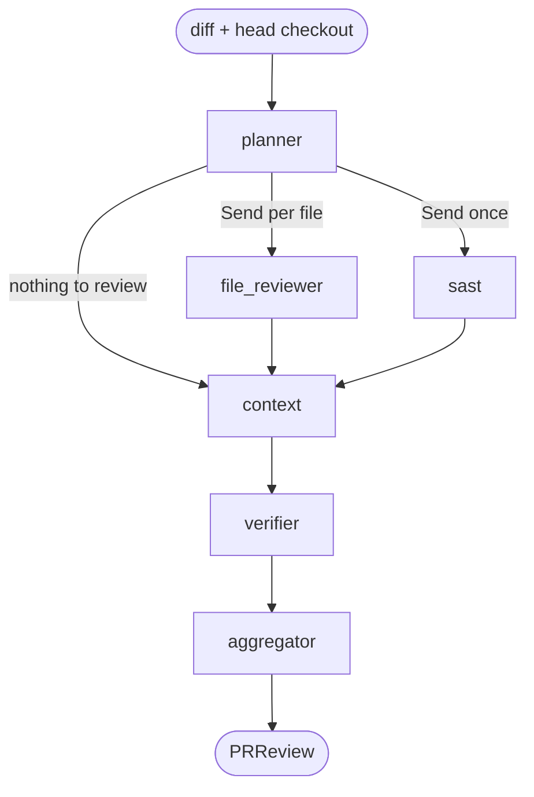

# The review pipeline

This page walks through the LangGraph graph that reviews a pull request, step by step: what each
node does, what it decides and which setting controls it. It is for readers who want to
understand why a hunk was or was not reviewed, or to tune a review. The design decisions are in
[ADR 0010](../adr/0010-review-pipeline.md), [0008](../adr/0008-gate-classifier.md),
[0012](../adr/0012-sast-evidence.md) and [0013](../adr/0013-routing-redaction-injection.md).

## The graph

The code is `prism/review/graph.py`. The planner runs first and fans out with LangGraph `Send()`:
one branch for each file that has hunks to review, and one branch for static analysis. The
branches run at the same time, and their results meet again in the context step. Each node is one
span in the Langfuse trace.

Every model call in a review shares one `asyncio.Semaphore` sized by `PRISM_MODEL_CONCURRENCY`
(default 4), so the number of requests in flight never exceeds the limit however many files fan
out. A graph is built per review, so the limit is per review.

## 1. Planner

The planner decides which files and hunks go to a model, and in what order
(`prism/review/plan.py`).

**Files that are not reviewed.** Binary files, deleted files, lock files and generated files
(for example `uv.lock`, `package-lock.json`, `*.min.js`, images) and files with no hunks are left
out. The summary lists them with the reason.

**File risk.** Each file gets a score from 0 to 1:

| Signal | Contribution |
|---|---|
| The path or the added code looks security-sensitive | 0.5 |
| Size: changed lines divided by 100 | up to 0.3 |
| Churn: commits touching the file among the last 200, when the checkout has git history | up to 0.2 |

A path looks security-sensitive when it contains words such as `auth`, `login`, `token`,
`crypt`, `session`, `permission`, `payment`, `middleware` or `settings.py`. Added code looks
security-sensitive when it matches patterns such as `subprocess`, `shell=True`, `pickle.loads`,
`yaml.load(`, `verify=False`, MD5 or SHA-1 hashing, SQL built from an f-string or concatenation,
`ObjectInputStream`, `innerHTML` and `password`. The patterns cover Python and Java and are a
starting point, not a tuned list. The reasons a file scored what it did are in the review summary
under "Risk signals".

**The gate.** The planner scores every hunk with the gate, a CodeBERT classifier exported to ONNX
(`prism/models/gate.py`). The score is the probability that a human would leave a comment on the
hunk, and a hunk is passed on when its score is at or above the threshold stored with the model.
The gate runs in the planner, not in each file reviewer, because the hunk budget is per pull
request: choosing the best hunks across all files needs every hunk's score first. The gate is
cheap, so scoring everything up front costs little.

`PRISM_GATE` selects it. The default `pass-all` lets every hunk through; `onnx` loads the model
from `PRISM_GATE_MODEL_DIR` and raises if the directory is missing instead of silently passing
everything.

!!! note
    A hunk whose path or added code looks security-sensitive skips the gate. The gate was trained
    on review comments in general, and missing one of these hunks costs more than one extra model
    call.

**Hunk budget.** The hunks that pass are ranked by file risk plus gate score, highest first, with
ties kept in diff order. The first `PRISM_REVIEW_MAX_HUNKS` (default 40) are reviewed. The rest
are listed in the summary as not reviewed with the reason `budget`. Hunks the local model does not
start before `PRISM_REVIEW_TIME_LIMIT_S` (default 600) are listed with the reason `time`.

**Routing.** After the budget, the router marks the hunks that go to Claude instead of the local
model. See [Verification and routing](verification-and-routing.md#routing).

## 2. File reviewer: the local model

One branch per file reviews that file's selected hunks, all at once, under the shared limit
(`prism/review/reviewer_client.py`, `prism/models/reviewer.py`).

**The prompt.** The reviewer sees the hunk alone, in a fenced `diff` block, with a short system
prompt that asks for one comment as JSON: `{"comment": "..."}`. It is trained and served with
exactly this prompt. It does not see retrieved code, because it was fine-tuned on hunks only
(`PRISM_REVIEWER_CONTEXT` turns context on as an evaluation setting). The default model is
`prism-reviewer:v2` (`PRISM_REVIEWER_MODEL`); the untuned `qwen2.5-coder:3b` also works.

**Bad replies.** The first attempt is greedy (temperature 0). A reply that is not the JSON asked
for is retried up to `PRISM_REVIEWER_RETRIES` (2) more times, with a little sampling (temperature
0.4 and a seed) so the retries can differ. After that the hunk is listed as `model_failed`. A
request that raises (Ollama down, timeout) is not cached, so a rerun tries again.

**Line anchoring.** The model writes only the comment text, because its training data has no line
labels. The line is chosen afterwards by `anchor_line`: the changed line that shares the most
identifiers with the comment wins, with added lines preferred on a tie. When no changed line
shares an identifier, the comment goes on the last added line, else the first removed line, else
the first line of the hunk. Identifiers are words of three or more characters, minus a list of
common English and code words. The verifier can later move a comment to a better line, but only to
a line the hunk shows.

**Cached replies.** Each outcome (a comment, a failure or a timeout) is cached per hunk in
`replies.json` in the work directory, keyed by model, path and a hash of the hunk. A rerun of the
same review, such as the second run of the handoff, calls no model.

## 3. SAST

The `sast` branch runs next to the file reviewers, in a thread, so the tools work while the model
does (`prism/review/sast.py`, `prism/review/injection.py`).

- **Tools.** `PRISM_SAST_TOOLS` (default `bandit,semgrep,ruff,pmd`). Bandit, Semgrep and Ruff
  check Python; Semgrep and PMD check Java. Each runs once, as a subprocess on the changed files
  at the head checkout. Bandit and Semgrep come from `uv sync --group sast`; PMD needs Java and
  `PRISM_PMD_HOME`. Semgrep runs with `--metrics=off` and the ruleset in `PRISM_SEMGREP_CONFIG`
  (default `p/owasp-top-ten`, fetched from the Semgrep registry on first use). Ruff runs only the
  rules that point at bugs, with `--isolated`.
- **The injection scan.** A built-in check named `prism` runs with the tools on every changed
  text file. See [Security and privacy](security-and-privacy.md#prompt-injection).
- **Failures.** A tool that is missing or fails is skipped, and the summary says so. A review
  never fails because of static analysis. `--no-sast` skips it.

Subprocesses start with an empty stdin, because under MCP the server's stdin is the protocol pipe.

## 4. Context

The context step (`context` in the graph) joins the file reviewers' comments and the tool
findings, then prepares everything the verifier needs.

1. **Tie findings to hunks.** A tool finding is attached to a hunk when its line is on the new side
   of a reviewed hunk. A finding outside every reviewed hunk is ignored: it is about code the pull
   request did not change, or about a hunk the gate or the budget left out.
2. **Tool comments.** A finding on an added line at or above `PRISM_SAST_COMMENT_MIN_SEVERITY`
   (default `medium`) also becomes a comment of its own, authored by the tool. Only one tool
   comment is made per line: when Bandit and Semgrep report the same issue, the strongest finding
   becomes the comment and the others stay as evidence.
3. **Retrieve code.** For every hunk that has a comment (from the model or a tool) or was
   escalated, PRism builds the context block: callers, tests, the enclosing class and similar
   code, ranked and packed into a token budget. See
   [Code graph and retrieval](code-graph-and-retrieval.md).

Only the verifier reads the context and the findings. The local reviewer does not.

## 5. Verifier

The verifier is Claude, plus deterministic checks that run first
(`prism/review/checks.py`, `prism/review/handoff.py`).

**Rule checks.** Every candidate comment must pass these before Claude sees it:

- its line is on the new side of its hunk (`line_not_in_diff` otherwise);
- it is not vague: a comment under 8 words that names nothing in the hunk (no shared identifier,
  no backticks, no code-like token) is dropped as `vague`;
- it does not repeat a comment already kept: the same text anywhere in the pull request, or a near
  copy (word overlap of 0.6 or more) on the same line is dropped as `duplicate`.

These checks catch form, not truth. Checking the claim is Claude's job.

**Claude's checks.** For each comment that passed, Claude returns whether to keep it, a severity,
a category, a confidence and the evidence it rests on. A comment is posted only if the verdict
keeps it, its confidence is at least `PRISM_VERIFIER_MIN_CONFIDENCE` (default 0.6), and, for a
security comment, it cites evidence. The routing, the two rubrics, the second round and the
handoff are in [Verification and routing](verification-and-routing.md).

`PRISM_VERIFIER=rules` skips Claude: the deterministic checks run, comments get keyword-based
labels and a fixed confidence of 0.3, and nothing is escalated. It exists for offline use and for
tests, and its comments have not been checked for truth.

## 6. Aggregator

The aggregator turns the verifier's decisions into the review (`prism/review/aggregate.py`).

- **Duplicates.** Comments on the same line in the same category are one finding said twice (for
  example Claude and Bandit on an SQL injection). The strongest is kept and the other is not
  counted as cut.
- **Cap.** Comments are ranked by severity, then security first, then confidence, and cut to
  `PRISM_REVIEW_MAX_COMMENTS` (default 20). The summary says how many were cut.
- **Verdict.** The risk verdict is computed from the kept comments, never asked of a model:
  `high` for any critical comment or any major security comment; `medium` for any major comment
  or hunks left out by the budget in a security-sensitive file; `low` otherwise.
- **Summary.** It lists the risk, the number of comments and reviewed hunks, severities, hunks
  skipped by the gate, hunks not reviewed (with reasons), files not reviewed, risk signals, the
  SAST results, the routing (how many hunks went to the local model and how many to Claude) and
  how many comments the verifier dropped.

## What the review reports

`PRReview` (`prism/schemas.py`) holds the summary, the verdict, the files with their comments and
per-file counts of hunks reviewed, skipped by the gate and over budget, the cost
(`cost_usd`, which is 0 for the handoff) and the duration. Each comment has a path, a line, a
severity, a category, a confidence, the model or tool that wrote it, its evidence and, for
Claude's comments, a suggested fix.

Dropped comments are not in the review, but they are stored with the reason, so you can ask why
PRism said nothing about a line: the MCP tool `explain_finding` and the dashboard read them
([ADR 0015](../adr/0015-stored-reviews.md)).

## Settings that shape a review

| Setting | Default | Effect |
|---|---|---|
| `PRISM_GATE` | `pass-all` | `onnx` filters hunks the classifier scores below its threshold |
| `PRISM_REVIEW_MAX_HUNKS` | `40` | Hunk budget per pull request |
| `PRISM_REVIEW_TIME_LIMIT_S` | `600.0` | Hunks not started by then are not reviewed |
| `PRISM_MODEL_CONCURRENCY` | `4` | Model calls in flight at once; match `OLLAMA_NUM_PARALLEL` |
| `PRISM_REVIEWER_RETRIES` | `2` | Retries for a reply that is not valid JSON |
| `PRISM_SAST_TOOLS` | `bandit,semgrep,ruff,pmd` | Tools to run; empty turns SAST off |
| `PRISM_SAST_COMMENT_MIN_SEVERITY` | `medium` | Lowest tool severity that becomes a comment |
| `PRISM_VERIFIER_MIN_CONFIDENCE` | `0.6` | Lowest confidence that is posted |
| `PRISM_REVIEW_MAX_COMMENTS` | `20` | Comment cap |

The full list is in the [configuration reference](../reference/configuration.md).
