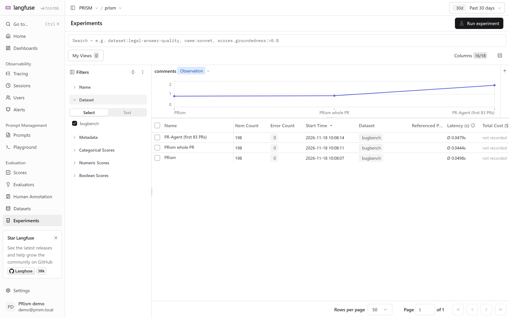

# BugBench

BugBench is the benchmark I built to measure PRism: pull requests where the bug and its line are known, plus pull requests with no known bug. This page explains how it is built, how it is scored and what it showed. It is for anyone who wants to judge how far the numbers can be trusted. To run it yourself, see [Running BugBench](running-bugbench.md).

## Why a new benchmark

To measure a reviewer I need pull requests where I know there is a bug and where it is, plus pull requests with no known bug to count false positives. Existing review datasets give a hunk and a human comment, not a defect at a known line. So every case in BugBench is a real commit from an open-source repository, reviewed as a pull request against its parent. The defect sits inside a real change with its tests and docs, not alone in a one-line diff. See [ADR 0021](../adr/0021-bugbench.md).

## The repositories

| Repository | Language | Licence | Why it is here |
|---|---|---|---|
| TinyDB | Python | MIT | Small, well tested |
| aiosqlite | Python | MIT | Async code, so a missing `await` is a real risk |
| sqlite-utils | Python | Apache-2.0 | Builds SQL |
| jsoup | Java | MIT | A second language |

Each repository has a test command and its own test environment, listed in `bugbench/repos.toml`.

## The 198 cases

| Kind | Cases | What it is |
|---|---|---|
| Planted | 139 | A real commit with one defect planted in a line the commit added |
| Real | 30 | A commit that introduced a bug that a later commit fixed |
| Clean | 29 | A commit whose tests pass, with no planted bug |

One commit is one case only; the loader refuses two cases on the same commit.

### Planted bugs

One defect is planted in a line the commit added: an off-by-one, a wrong null check, a wrong boolean operator, an inverted condition, a missing `await`, a wrong exception type, swapped arguments, a wrong return value, a dropped `close()`.

`prism bench generate` proposes mutations and keeps one only if the repository's tests pass at the commit and a named test fails with the mutation. So every planted bug is a real behaviour change that a test catches. Mutants that do not parse or compile are dropped, and no kind of defect takes more than about a fifth of a repository's cases. Three SQL injections in sqlite-utils are written by hand.

### Real bugs

A real case is a commit that introduced a bug a later commit fixed. `prism bench real` finds candidates with SZZ: it blames the lines a fix changed back to the commit that wrote them. Each candidate is then checked by hand: the fix must change behaviour, and the blamed lines must be the faulty code added by that commit.

Ten cases came from a first, smaller search. In the second search 32 of 208 candidates passed the hand check, and I took 20 of them, spread across the repositories.

### Clean pull requests

Clean cases are commits whose tests pass and that got no planted bug. They exist to count false positives: a clean PR is flagged when PRism comments on it at all.

## How a case is reviewed

Each case is checked out in its own git worktree with the defect planted, and reviewed by the normal pipeline with the repository indexed in memory. Claude's work goes through the same handoff as everywhere else in PRism: the runner gathers the open requests of every case into one round folder with a neutral README that says nothing about whether a PR has a bug, Claude answers it, and the next pass hands the answers back. Local replies and Claude's answers are cached per case.

## Scoring

Scoring lives in `prism/bench/score.py` and `prism/bench/judge.py`.

* **Found.** A planted or real bug is found when a posted comment is on the defect's file within 3 lines of the defect.
* **Clean flagged.** A clean PR is flagged when it gets any posted comment.
* **Comments per buggy PR.** The number of posted comments on PRs that have a bug, averaged.
* **The comment judge.** Every posted comment is also shown to a judge (Claude, through the same handoff as the verifier) with the hunk it sits on and, for a buggy PR, a description of the defect. The judge answers two questions:
    * Is it a true, useful review comment about this change? The share judged true is **precision**.
    * Does it name the planted or real bug, wherever it is placed? A buggy PR counts as "named" when any of its comments does.

The judge exists because the 3-line window says where a comment is, not what it says. A comment on a call site four lines away can name the bug exactly, and a comment on the defect line can be about something else.

## Results on all 198 pull requests

The main run uses PRism as shipped: the planner, the ONNX gate, the fine-tuned local reviewer, static analysis, graph context, routing to Claude, and the verifier at the default confidence threshold of 0.6. The second column is the whole-PR setup, where Claude reads every hunk of a PR in one request and the local reviewer is not called. The full table, with the outcome of every case, is in `eval/reports/bugbench.md`.

| | PRism | Whole PR to Claude |
|---|---|---|
| Planted bugs found | 115/139 | 124/139 |
| Real bugs found | 17/30 | 18/30 |
| Clean PRs with any comment | 0/29 | 1/29 |
| Comments per buggy PR | 0.99 | 1.02 |

The judge rated 162 of the 167 comments PRism posted as true and useful (precision 0.97). It found a comment naming the defect in 117 of the 139 planted-bug PRs and in 17 of the 30 real ones. Of PRism's planted-bug finds, 23 came straight from the fine-tuned local reviewer.

!!! note
    Planted bugs are test-checked, and the reviewer sees the commit's own tests in the PR. Real bugs have no such filter, which is one reason they are harder. I report the two apart. Many old commits cannot run their tests in today's environment, so planted cases lean towards recent history; aiosqlite has fewer cases than the others for that reason.

### The confidence threshold

`PRISM_VERIFIER_MIN_CONFIDENCE` (0.6) decides which of Claude's comments are posted. Each run's saved answers can be re-scored at other thresholds with no new Claude work ([ADR 0026](../adr/0026-threshold-sweep.md)). On all 198 PRs:

| Threshold | PRism planted | PRism real | PRism clean flagged | Whole PR planted | Whole PR real | Whole PR clean flagged |
|---|---|---|---|---|---|---|
| 0.30 | 119/139 | 19/30 | 2/29 | 127/139 | 23/30 | 5/29 |
| 0.40 | 118/139 | 19/30 | 1/29 | 125/139 | 23/30 | 5/29 |
| 0.50 | 117/139 | 19/30 | 1/29 | 125/139 | 20/30 | 4/29 |
| 0.60 | 115/139 | 17/30 | 0/29 | 124/139 | 18/30 | 1/29 |
| 0.70 | 109/134 | 14/29 | 0/29 | 123/139 | 15/30 | 0/29 |
| 0.80 | 105/131 | 11/29 | 0/29 | 119/139 | 13/30 | 0/29 |
| 0.90 | 84/126 | 5/29 | 0/29 | 107/139 | 6/30 | 0/29 |

For PRism at 0.70 and above, some PRs are unscored (6, 9 and 14 at 0.70, 0.80 and 0.90): at those thresholds PRism would ask Claude something the run never asked, so the counts cover the scored PRs only.

Lowering the threshold to 0.4 finds more bugs (118 planted and 19 real, against 115 and 17) but puts a comment on 1 of the 29 clean PRs, where 0.6 puts none. So 0.6 stays the default, and lowering it is a documented trade of recall for comments on clean code. Above 0.6 every setup loses bugs quickly, and no clean PR is flagged at 0.6 or above anyway.

## Comparison and ablations

!!! warning
    Everything in this section was measured on the **first 83 pull requests** of BugBench (57 planted bugs, 10 real bugs, 16 clean PRs), before the benchmark grew to 198. These numbers are not comparable with the table above. The PR-Agent baseline and the ablations were not re-run on the larger set.

### PRism against PR-Agent

I ran Qodo's open-source PR-Agent 0.49.0 on the same pull requests, with Claude behind it through the same kind of handoff, so both tools use the same model. PR-Agent ran its `review` and `improve` tools on a local git provider with default settings. A finding counted as a hit when it was on the defect's file and its line range came within 3 lines of a defect line. See [ADR 0022](../adr/0022-pr-agent-baseline.md).

| | PRism | PR-Agent |
|---|---|---|
| Planted bugs found | 48/57 | 54/57 |
| Real bugs found | 6/10 | 8/10 |
| Clean PRs with any comment | 0/16 | 2/16 |
| Comments per buggy PR | 1.00 | 2.03 |
| Claude requests / input | 519 / 2.9 MB | 227 / 3.8 MB |

With the same model behind both, PR-Agent found more bugs here. PRism posted half as many comments, put none on a clean PR, and sent Claude about a quarter less input. Time is not compared, because neither run times Claude.

### Ablation: Claude reviews every hunk

Replacing the local reviewer with Claude on every hunk (`PRISM_ROUTE_ALL=true`) changed almost nothing: 49/57 planted bugs and 6/10 real bugs, against 48/57 and 6/10. Of its 12 misses, 3 were hunks that never reached Claude (the gate or the hunk budget left them out), 3 were named at confidence 0.35 to 0.5 and dropped by the threshold, 1 was named at a call site 4 lines from the defect, and 5 were hunks Claude saw and said nothing about. The fine-tuned reviewer is not what costs recall; the pipeline around it is. See [ADR 0023](../adr/0023-ablation-claude-only.md).

### Ablation: the gate off

With the CodeBERT gate off (`PRISM_GATE=pass-all`), PRism found 50/57 planted bugs instead of 48/57 and the same 6/10 real bugs, with no new comments on clean PRs. The gate skips 29% of the hunks (425 sent to the local model instead of 600) and saves 24% of the Claude requests (519 instead of 686). Its cost is 2 of 57 planted bugs. The default stays on. See [ADR 0024](../adr/0024-ablation-gate.md).

### Ablation: the whole-PR view

Showing Claude the whole pull request in one request (`PRISM_REVIEW_UNIT=pr`, with `PRISM_ROUTE_ALL=true`), instead of one hunk per request, was the change that moved recall most. The same hunks and context went to Claude in both runs, and Claude wrote about the same number of comments; what it wrote landed on the bug more often.

| | Claude, per hunk | Whole PR | Whole PR, threshold 0.3 | PR-Agent |
|---|---|---|---|---|
| Planted bugs found | 49/57 | 52/57 | 52/57 | 54/57 |
| Real bugs found | 6/10 | 5/10 | 9/10 | 8/10 |
| Clean PRs with any comment | 0/16 | 0/16 | 2/16 | 2/16 |
| Comments per buggy PR | 0.99 | 1.00 | 1.40 | 2.03 |

At threshold 0.3 the whole-PR view found 9 of 10 real bugs, one more than PR-Agent, with the same 2 clean PRs flagged and about two thirds of its comments. This is not a production mode: one request per PR grows with the PR, and a size limit and a way to split a PR by file are not built. The default stays per hunk. See [ADR 0025](../adr/0025-ablation-whole-pr.md).

### Threshold sweep on the first 83 PRs

Injected recall, real-bug recall and clean PRs flagged, per threshold ([ADR 0026](../adr/0026-threshold-sweep.md)):

| Threshold | PRism | Claude, per hunk | Whole PR |
|---|---|---|---|
| 0.3 | 50/57, 7/10, 1/16 | 51/57, 7/10, 3/16 | 52/57, 9/10, 2/16 |
| 0.4 | 50/57, 7/10, 0/16 | 50/57, 7/10, 3/16 | 52/57, 9/10, 2/16 |
| 0.5 | 49/57, 7/10, 0/16 | 49/57, 7/10, 1/16 | 52/57, 6/10, 1/16 |
| 0.6 | 48/57, 6/10, 0/16 | 49/57, 6/10, 0/16 | 52/57, 5/10, 0/16 |

On these 83 PRs a threshold of 0.4 looked better than 0.6 for PRism. The 198-PR table above did not confirm that it was free: it costs a comment on one clean PR. The whole-PR view at 0.4 was the best configuration measured on the 83 PRs (52/57, 9/10, 2/16 clean), against PR-Agent's 54/57, 8/10 and 2/16.

## What the numbers do not show

* The four repositories are small and well known. How PRism does on a large private codebase is not measured.
* Planted bugs are single-line mutations. They are real behaviour changes that a test catches, but they are not shaped like every bug people write.
* Real-bug recall rests on 30 cases, so one case moves it by more than three points.
* Whether the extra comments a lower threshold posts are useful is not measured in the sweep; the judge was run on the main run only.
* The ±3-line window undercounts comments on a call site. The judge's "named" count (117/139 planted, 17/30 real) is the answer to that.
* The ablations and the PR-Agent comparison cover 83 of the 198 PRs.

## Reproducing it

See [Running BugBench](running-bugbench.md). The tables here come from `eval/reports/bugbench.md`, `eval/reports/bugbench_vs_pr_agent.md`, `eval/reports/bugbench_ablation_claude_only.md`, `eval/reports/bugbench_ablation_gate.md`, `eval/reports/bugbench_ablation_whole_pr.md` and `eval/reports/bugbench_threshold_sweep.md`. The finished runs can be published to Langfuse as experiments with `prism bench experiments`:

