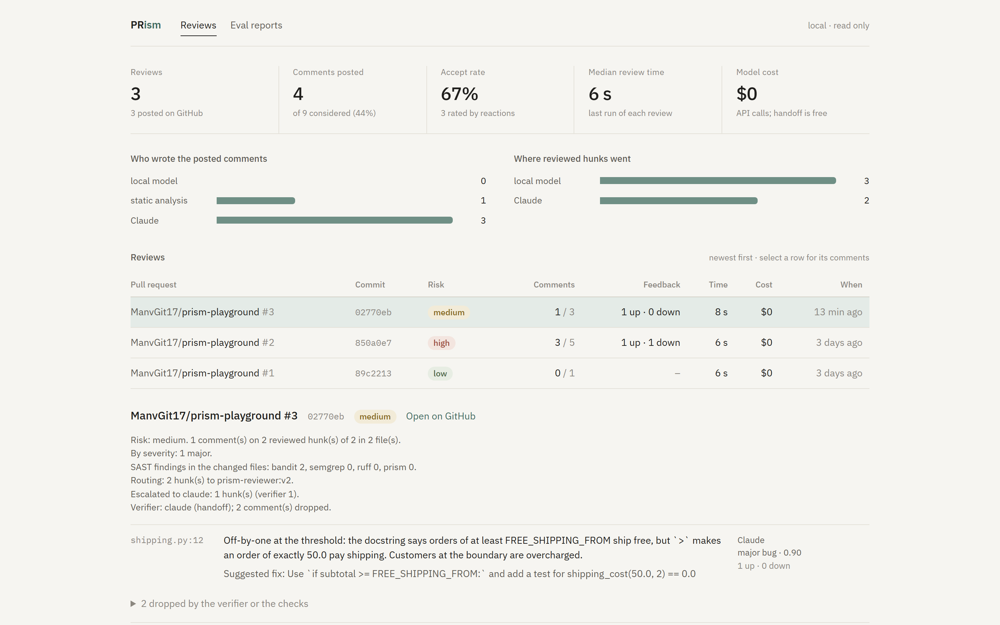

# The dashboard

This guide shows how to build and serve PRism's dashboard and explains what it shows. It is for anyone who wants an overview of the reviews PRism has run, locally or through the GitHub App.

## Build and serve

The dashboard is a React page in `dashboard/`, served by a small read-only API. You need Node.js to build the page and the `app` group to serve it.

```bash
cd dashboard
npm ci
npm run build        # type-checks, then writes dashboard/dist
cd ..
uv sync --group app
make up              # Postgres, where the reviews are
uv run prism dashboard --port 8090
```

Open <http://127.0.0.1:8090>. The server listens on `127.0.0.1` only, and `--port` defaults to 8090. Without `dashboard/dist` the server runs but shows a page saying it has not been built.

!!! note
    With Postgres down, the dashboard shows an empty in-memory store. It reads reviews; it never starts one.

## What it shows



**Reviews tab.**

- **Headline figures.** Reviews (and how many were posted on GitHub), comments posted out of comments considered, accept rate, median review time, and model cost.
- **Who wrote the posted comments.** Posted comments by author: the local model, static analysis, or Claude.
- **Where reviewed hunks went.** How many hunks were routed to the local model and how many to Claude.
- **Reviews.** One row per review, newest first: pull request, commit, risk, comments posted out of considered, feedback (thumbs up and down), time, cost and age. Select a row to open it.
- **Review detail.** The review's summary, each posted comment with its file, line, author, severity, category, confidence and feedback, and a folded list of the comments the verifier or the checks dropped, with the reasons. A link opens the pull request on GitHub.

**Eval reports tab.** The Markdown reports in `eval/reports`, such as the BugBench results, rendered as written.

## How the numbers are computed

- **Comments posted of considered.** Shows how much the verifier and the checks keep.
- **Accept rate.** Comments rated good divided by comments rated good or bad, among comments people rated with reactions or by resolving the thread. The figure says how many were rated.
- **Median review time.** Each review's last run. For a held review that is the fast rerun from cached replies, not the first pass.
- **Model cost.** What API calls reported. The handoff verifier is not metered, so it shows $0.
- **Routing.** Read from each review's summary lines, since the store keeps no per-hunk routing record.

## Where the data comes from

The dashboard reads the review store in Postgres (`PRISM_POSTGRES_*`), which `prism review` fills (unless `PRISM_REVIEW_STORE=off`), as do the [MCP server](claude-code-mcp.md) and the [GitHub App](github-app.md). Feedback comes from the same store, filled by the [feedback loop](langfuse.md#the-feedback-loop). The reports come from the `eval/reports` folder of the repo.

The JSON API behind the page is read-only: `/api/summary`, `/api/reviews`, `/api/reviews/{id}`, `/api/reports` and `/api/reports/{name}`. The design is in [ADR 0020](../adr/0020-dashboard.md).
