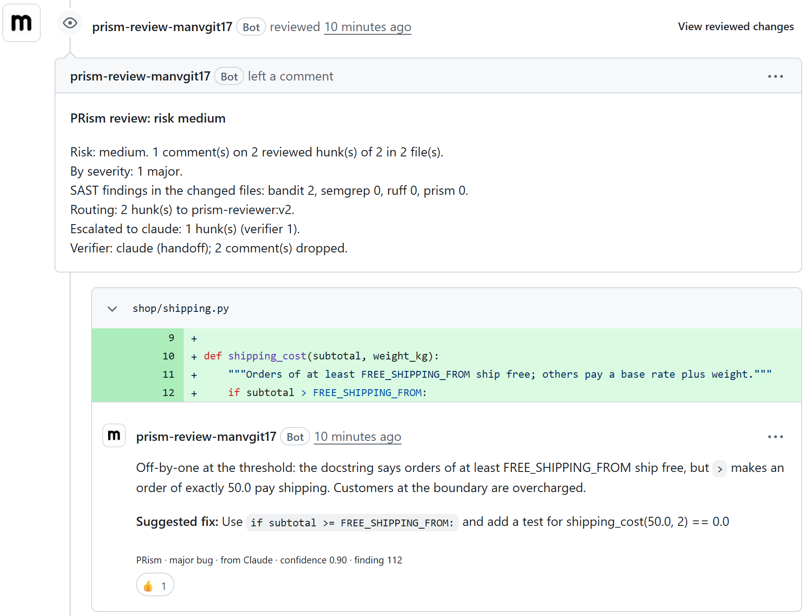

# Running the GitHub App

This guide shows how to register PRism as a GitHub App, run it with polling or a webhook tunnel, run the review queue, and read what it posts. It is for someone who wants PRism to review pull requests on their own repositories.

## Register the App

In GitHub, go to Settings, Developer settings, GitHub Apps, New GitHub App.

| Setting | Value |
|---|---|
| Webhook URL | Your tunnel URL plus `/webhook`. You can leave it empty if you only poll. |
| Webhook secret | A random string you choose. It goes into `.env` as well. |
| Repository permission: Pull requests | Read and write |
| Repository permission: Contents | Read-only |
| Subscribe to events | `Pull request`, `Pull request review comment`, `Pull request review thread` |

Pull request is the one that starts reviews. The two review events carry [feedback](langfuse.md#the-feedback-loop). Then generate a private key (a `.pem` file) and install the App on the repositories to review.

Keep the key outside the repo. Put the App id, the key's path and the webhook secret in `.env`:

```bash
PRISM_GITHUB_APP_ID=123456
PRISM_GITHUB_PRIVATE_KEY_PATH=/path/outside/the/repo/prism-app.pem
PRISM_GITHUB_WEBHOOK_SECRET=the-secret-you-set
```

Other settings you may want (defaults in the [configuration reference](../reference/configuration.md)):

| Variable | Default | What it does |
|---|---|---|
| `PRISM_APP_POLL_INTERVAL_S` | `30` | Seconds between scans in polling mode. |
| `PRISM_APP_MAX_CHANGED_LINES` | `3000` | PRs with more changed lines are skipped. |
| `PRISM_APP_CHECKOUT_DIR` | `.prism-work/checkouts` | Shallow checkouts of PR heads. |
| `PRISM_APP_POST_EMPTY` | `first` | A review with no comments: `first` posts it only if PRism has not reviewed the PR before, `always`, or `never`. |
| `PRISM_VERIFIER` | `handoff` | `api` makes the App finish and post on its own. |
| `PRISM_APP_QUEUE` | `inline` | `celery` runs reviews on a worker, see below. |

## Run the server

Install the groups and start the server:

```bash
uv sync --group app --group sast --group mcp
make up
uv run prism app serve --port 8080 --poll
```

`prism app serve` listens on `127.0.0.1:PORT` (8080 by default). `POST /webhook` checks the `X-Hub-Signature-256` signature against your secret and answers `202` at once; `GET /health` answers `ok`. Only `pull_request` events that open, reopen, push to or un-draft a non-draft PR start a review.

### Polling

With `--poll`, the server also scans every installed repository each `PRISM_APP_POLL_INTERVAL_S` seconds, reviews open PR head commits that have no review yet, and posts held reviews whose answers have arrived. This needs no tunnel. `prism app poll` does the same without the web server, and `prism app poll --once` does one pass.

### Webhook tunnel

GitHub cannot reach `127.0.0.1`, so for webhooks put a tunnel in front of the server, such as a [smee.io](https://smee.io) channel forwarding to `http://127.0.0.1:8080/webhook`, and use the channel URL as the App's webhook URL. A redelivered event is dropped by its delivery id. You can run with both: the webhook gives fast starts and polling covers missed deliveries.

!!! note
    Postgres is where reviews are stored. If it is down, the App keeps them in memory, and held reviews are lost when the process stops.

## Held reviews

With the default `handoff` verifier a review cannot finish until Claude has answered its requests, so the App holds it. A held review is stored as `awaiting_verification`, a `job.json` next to its requests names the PR, and nothing is posted.

To answer it:

1. Call `pending_reviews` from Claude Code with the [MCP server](claude-code-mcp.md). Each entry has a `work_dir`.
2. Answer the requests in that `work_dir` with `submit_answers`, or write the `verdicts_NN.jsonl` and `reviews_NN.jsonl` files by hand as in [Reviewing from the CLI](reviewing-from-the-cli.md#the-handoff-loop).
3. The review is posted on the next pass: the next poll, `prism app resume`, or the next minute of the Celery beat. It reruns from cached replies, so it takes seconds.

Before posting, PRism checks the PR is still open and still at the reviewed commit. If someone pushed in the meantime, the result is dropped as superseded, since its line numbers may be stale, and the new push gets its own review. A review is never posted twice.

With `PRISM_VERIFIER=api` (`uv sync --group frontier` and `ANTHROPIC_API_KEY`), reviews finish and post in one run.

## The queue: Celery worker and beat

By default the web process reviews PRs itself, one at a time. For retries, per-installation limits and survival across restarts, use Celery with Redis (started by `make up`):

```bash
# .env
PRISM_APP_QUEUE=celery

uv run prism app serve --port 8080       # queues reviews
uv run prism app worker                  # runs them
uv run prism app beat                    # schedules the periodic tasks
```

| Process | Job |
|---|---|
| `serve` | Receives webhooks and queues `prism.review_pull`. |
| `worker` | Reviews PRs. On Windows it uses the solo pool, since the default pool does not run there. Elsewhere `--concurrency N` sets the process count. |
| `beat` | Every minute posts held reviews that have been answered (`prism.resume_held`); every `PRISM_APP_FEEDBACK_INTERVAL_S` (900) reads feedback; and, with `PRISM_APP_POLL_WITH_BEAT=true`, polls for unreviewed PRs every `PRISM_APP_POLL_INTERVAL_S`. |

The queue acknowledges tasks late, retries GitHub rate limits and server errors with backoff (up to 5 times), skips a review whose commit has been superseded by a newer push, claims `repo#pr#head_sha` so a redelivery is not reviewed twice, and runs at most `PRISM_APP_REVIEWS_PER_INSTALLATION` (1) reviews at once per installation. Details are in [ADR 0018](../adr/0018-review-queue.md).

For Linux hosts, `docker compose --profile worker up -d` starts a worker and beat in containers. The App's private key is mounted read-only from the folder `PRISM_SECRETS_DIR` names (see `docker-compose.yml`).

## What PRism posts

One review with event `COMMENT` (never an approval or a request for changes): a summary as the review body and one inline comment per kept finding, on the line of the new file.



Each comment ends with a footer, such as `PRism · major bug · from Claude · confidence 0.90 · finding 112`: the severity and category, who wrote it (Claude, the local model or a static analysis tool), the verifier's confidence, and the finding id. The finding id is what you give to `explain_finding` in the [MCP server](claude-code-mcp.md) to see why it was posted. If Claude had a clear fix, the comment includes a **Suggested fix**.

## Feedback events

PRism learns from what people do with its comments. Subscribe the App to these events (already listed above):

| Event | What PRism does with it |
|---|---|
| `pull_request_review_comment` | A reply to a PRism comment counts as a reply. |
| `pull_request_review_thread` | A thread with a PRism comment marked resolved or unresolved sets the resolved flag. |

Thumbs-up and thumbs-down reactions are not webhook events. They are read by a periodic pass (`prism app feedback`, or the beat every 15 minutes) for comments posted in the last `PRISM_APP_FEEDBACK_WINDOW_DAYS` (14). Reactions from bots, PRism's own included, do not count. See [Langfuse](langfuse.md#the-feedback-loop) for where the feedback goes.

The design is in [ADR 0017](../adr/0017-github-app.md) and [ADR 0019](../adr/0019-comment-feedback.md).
