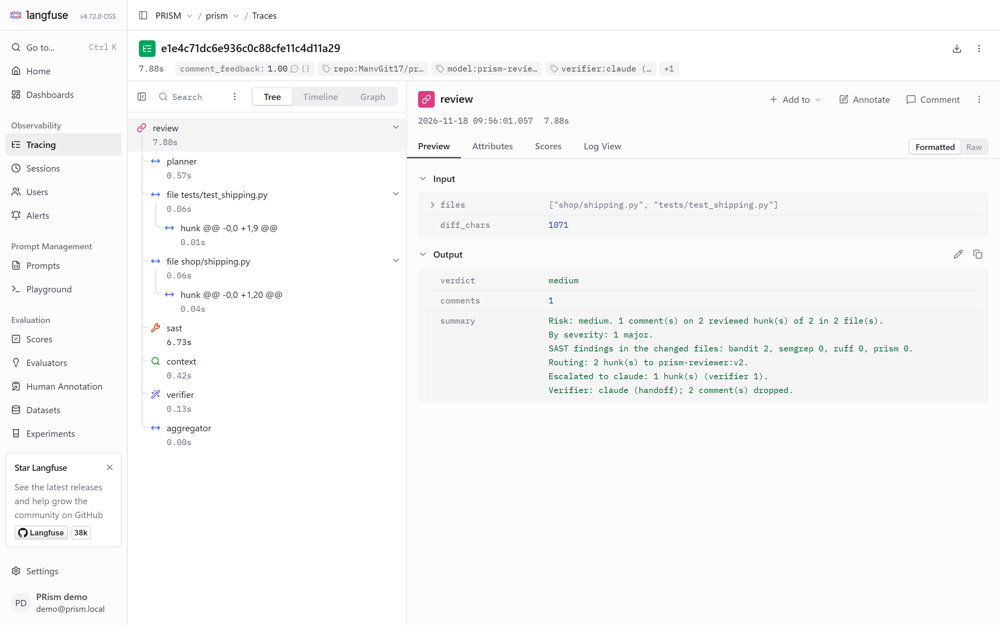
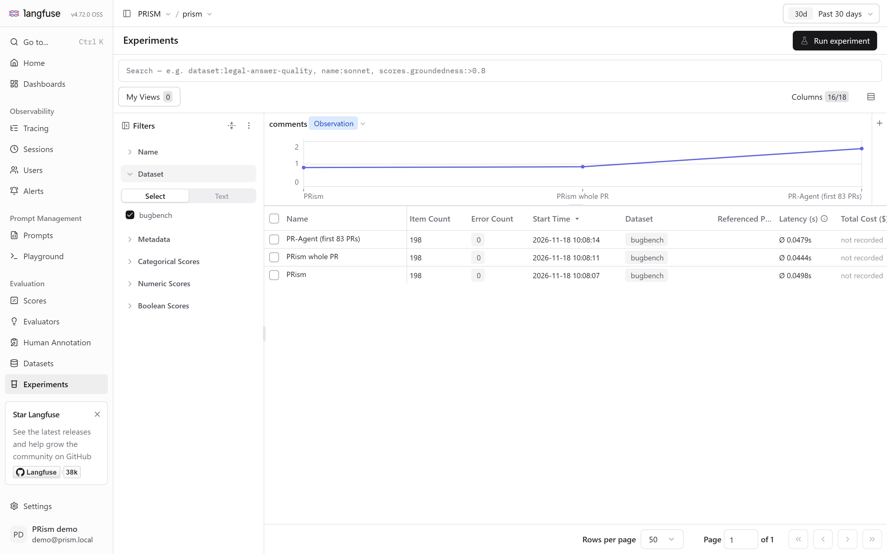

# Langfuse: traces, prompts, feedback and experiments

This guide shows how to run the self-hosted Langfuse next to PRism and use it for four things: tracing reviews, managing prompts, collecting feedback on posted comments, and comparing BugBench runs. It is for anyone who wants to see inside a review or tune PRism from real use.

## Start Langfuse

Langfuse v4 runs from a Compose profile of this repo, with its own Postgres, ClickHouse, Redis and MinIO. It adds about 1.9 GiB of memory, so start it only when you want it.

```bash
make langfuse-up
uv sync --group observability
```

The UI is at <http://localhost:3001>. The first start creates the `prism` organisation and project with API keys, but no user: click sign up, choose your own email and password, and you become the project's owner. `make langfuse-down` stops it.

The keys in the profile and in PRism's defaults (`PRISM_LANGFUSE_PUBLIC_KEY`, `PRISM_LANGFUSE_SECRET_KEY`, `PRISM_LANGFUSE_HOST=http://127.0.0.1:3001`) match, so nothing needs configuring for a local setup.

!!! warning
    Every port is bound to `127.0.0.1` and the passwords and keys are fixed local development values. That is fine on your own machine. Before exposing the server anywhere else, set your own values in `.env` (see the `LANGFUSE_*` variables in `docker-compose.yml`).

## Trace reviews

Turn tracing on in `.env`:

```bash
PRISM_TRACING=langfuse
```

Every review, from the CLI, the MCP server or the GitHub App, then writes one trace named `review`, tagged with the repo, the PR, the reviewer model and the verifier. `prism review` prints the trace URL.



The trace has these children:

| Span | What it holds |
|---|---|
| `planner` | Risk scores, which hunks were selected, and how they were routed. |
| `file <path>` | One per file, with a `hunk <header>` child per hunk. A hunk the local model reviewed is a generation linked to the prompt it used; an escalated or cached hunk is a plain span. |
| `sast` | The static analysis tools and their findings. |
| `context` | Retrieval for the verifier. |
| `verifier` | Every decision: kept, dropped and why. |
| `aggregator` | The final comments. |

A generation also records how long it waited for a model slot, because all hunks queue at once and a long span can mostly be waiting. Everything sent to Langfuse is redacted the same way as the requests to Claude. With the handoff verifier a review is two runs, so it makes two traces: the first ends with the verifier pending, and in the second the hunk spans are marked cached. The design is in [ADR 0014](../adr/0014-langfuse-tracing-and-prompts.md).

## Manage prompts

PRism has three prompts: the reviewer's system prompt (`prism-reviewer-system`) and the two Claude rubrics (`prism-verify-rubric`, `prism-review-rubric`). The code holds the reference text. To edit them in Langfuse:

1. Push the code's text as new versions with a label:

    ```bash
    uv run --group observability prism prompts push --label staging
    ```

    The default label is `staging`. The command lists each prompt and the version it created, and exits with code 3 if Langfuse rejects the keys.

2. Edit a prompt in the Langfuse UI under Prompts, and move the `production` label to the version you want.
3. Make PRism read prompts from Langfuse:

    ```bash
    PRISM_PROMPT_SOURCE=langfuse
    PRISM_PROMPT_LABEL=production
    ```

`PRISM_PROMPT_SOURCE` is `code` by default. With `langfuse`, each review reads every prompt by `PRISM_PROMPT_LABEL` (default `production`) and falls back to the text in the code when Langfuse is down or has no such prompt, so a review never fails over a prompt. To try a new text first, push with `--label staging` and run with `PRISM_PROMPT_LABEL=staging`.

!!! note
    The fine-tuned reviewer was trained on the exact text of its system prompt, and its Modelfile bakes the same text in. Serving a different reviewer prompt to it works but logs a warning. Changing that prompt makes sense mostly for the base model.

## The feedback loop

The loop turns what people do with PRism's comments on GitHub into scores, a dataset and training data. It needs the [GitHub App](github-app.md) running, with Postgres (`make up`) for the store.

**1. Reactions, replies and resolved threads.** The App records, per posted comment, the human thumbs-up and thumbs-down counts, replies, and whether the thread is resolved. Bots do not count, PRism's own reactions included.

- Replies and resolved threads arrive by webhook (`pull_request_review_comment`, `pull_request_review_thread`).
- Reactions are read by `prism app feedback`, one pass over comments posted in the last `PRISM_APP_FEEDBACK_WINDOW_DAYS` (14). The beat (`prism app beat`) runs the same pass every `PRISM_APP_FEEDBACK_INTERVAL_S` (900). Reads use ETags, so an unchanged comment costs no rate limit.

```bash
uv run --group app --group observability prism app feedback
```

The command prints counts of comments checked, unchanged, updated and sent.

**2. Labels.** A comment is `good` when thumbs-up outnumber thumbs-down, `bad` when thumbs-down outnumber thumbs-up, and `mixed` on a tie with votes. With no votes, a resolved thread counts as `good`; anything else has no label. A reply alone does not label a comment.

**3. Scores and the dataset.** With `PRISM_TRACING=langfuse` (or `PRISM_PROMPT_SOURCE=langfuse`), each labelled comment whose feedback changed is sent to Langfuse:

- A `comment_feedback` score on the review's trace, from -1 (all thumbs-down) to 1 (all thumbs-up). A resolved thread with no reactions scores 1. The score is attached to the trace, so tracing must have been on when the review ran.
- An item in the `prism-comment-feedback` dataset (`PRISM_FEEDBACK_DATASET`): the hunk as input, the comment as expected output, and the label, counts, severity, category, confidence, author and finding id as metadata.

Both use the id `prism-finding-<id>`, so new reactions update them instead of duplicating them. Without Langfuse, the feedback is still kept in Postgres and the next two commands work.

**4. Report.** `prism app feedback-report` reads the labelled comments of the last `--days` days (90) from Postgres:

```bash
uv run --group app prism app feedback-report --days 90 --target 0.8 --out feedback.md
```

It prints how many comments were rated, the useful share overall, and the same by author (local model, Claude, each static analysis tool), by category and by confidence band. It ends with a suggested threshold: the lowest of 0.6, 0.7, 0.8 and 0.9 at which comments at or above it were useful at least `--target` (0.8) of the time.

**5. Tune the threshold.** Set the suggestion as `PRISM_VERIFIER_MIN_CONFIDENCE` (default 0.6) in `.env`. Only posted comments carry feedback, so the report can tell you whether to raise the threshold, never how far you could lower it. If no threshold up to 0.9 reaches the target, the report says so.

**6. Export training data.** `prism app feedback-export` writes the rated comments and preference pairs:

```bash
uv run --group app prism app feedback-export --out data/feedback/rated.jsonl --days 90
```

This writes `rated.jsonl` (one row per rated comment: repo, PR, path, line, hunk, comment, author, category, severity, confidence, label and counts) and, next to it, `rated.pairs.jsonl`. Each line of the pairs file is `{"prompt", "chosen", "rejected"}`: a hunk with a comment people liked and one they did not. That is the format a DPO round on the reviewer takes. Hunks with only liked or only disliked comments produce no pair, so pairs need real usage. Training itself is covered in [Models](models.md#retrain-both-models).

The design is in [ADR 0019](../adr/0019-comment-feedback.md).

## BugBench experiments

BugBench's results can be replayed into Langfuse as experiments, so each configuration sits side by side. Nothing is reviewed again and no model is called: the command reads each run's saved results.

```bash
export PRISM_BENCH_ROOT=/path/outside/the/repo
uv run --group observability prism bench experiments bugbench/cases/*.toml \
    --runs "PRism=bb-prism,PRism whole PR=bb-whole-pr"
```

Pass the case files the runs used, and `--runs` as comma-separated `NAME=RUN` pairs, where `RUN` is a folder under `$PRISM_BENCH_ROOT/runs`. The command creates a `bugbench` dataset with one item per case, then one experiment per run. Item scores are `hit` (a comment within 3 lines of the defect), `comments`, and, once comments are judged, `valid_share` and `names_defect`. Run scores are `recall_injected`, `recall_real` and `clean_flagged` (the share of clean PRs with a comment).



Run `make eval-bugbench` first to produce the runs. The benchmark is described in [ADR 0021](../adr/0021-bugbench.md).
