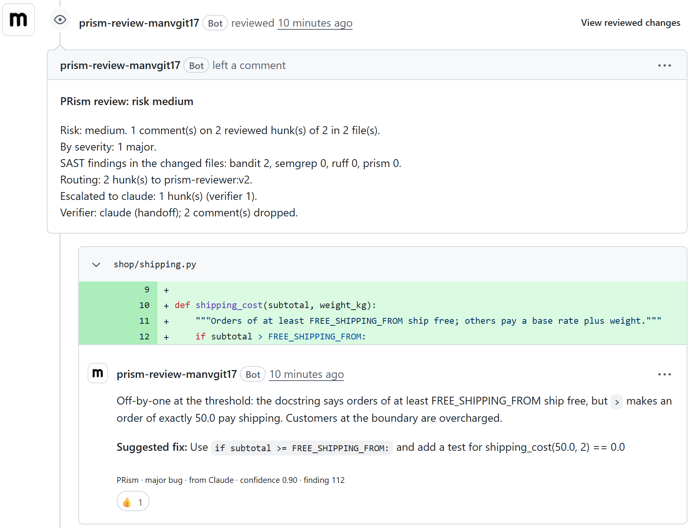

# PRism documentation

PRism is a code reviewer that understands the repository a pull request lands in. It builds a
graph of the code, reviews each changed hunk with a small model that runs on a laptop CPU, runs
static analysis alongside, and has Claude check every comment against the code before anything
is posted. It runs from the command line, inside Claude Code, or as a GitHub App.

## Where to start

| If you want to... | Read |
|---|---|
| Try it on a diff in ten minutes | [Quickstart](getting-started/quickstart.md) |
| Install everything properly | [Installation](getting-started/installation.md) |
| Understand how a review works | [Architecture](concepts/architecture.md) and [the review pipeline](concepts/review-pipeline.md) |
| Review from Claude Code | [Claude Code and MCP](guides/claude-code-mcp.md) |
| Review every pull request on a repository | [GitHub App](guides/github-app.md) |
| See traces, manage prompts and learn from feedback | [Langfuse](guides/langfuse.md) |
| Get or retrain the models | [Models](guides/models.md) |
| Know how good it is | [BugBench results](evaluation/bugbench.md) |
| Look up a setting or a command | [Configuration](reference/configuration.md), [CLI](reference/cli.md) |
| Know why it is built this way | [Design decisions](adr/index.md) |

## What PRism is made of

| Part | What it does |
|---|---|
| Code graph | tree-sitter parses Python and Java into Neo4j: files, classes, functions, calls and tests |
| Retrieval | callers, callees, tests and similar code for each hunk, reranked and packed into a token budget |
| Gate | a CodeBERT classifier (ONNX, CPU) that decides which hunks deserve the reviewer's time |
| Reviewer | Qwen2.5-Coder 3B fine-tuned with QLoRA, served by Ollama, one comment per hunk |
| Static analysis | Bandit, Semgrep, Ruff and PMD on the changed files |
| Verifier | Claude judges every comment, reviews risky hunks itself and escalates what was missed |
| Integrations | CLI, MCP server for Claude Code, GitHub App on FastAPI with a Celery queue, dashboard |
| Observability | self-hosted Langfuse: traces, prompts, feedback scores, datasets, experiments |
| Evaluation | BugBench: 198 real pull requests with known bugs, a judge and ablations |
