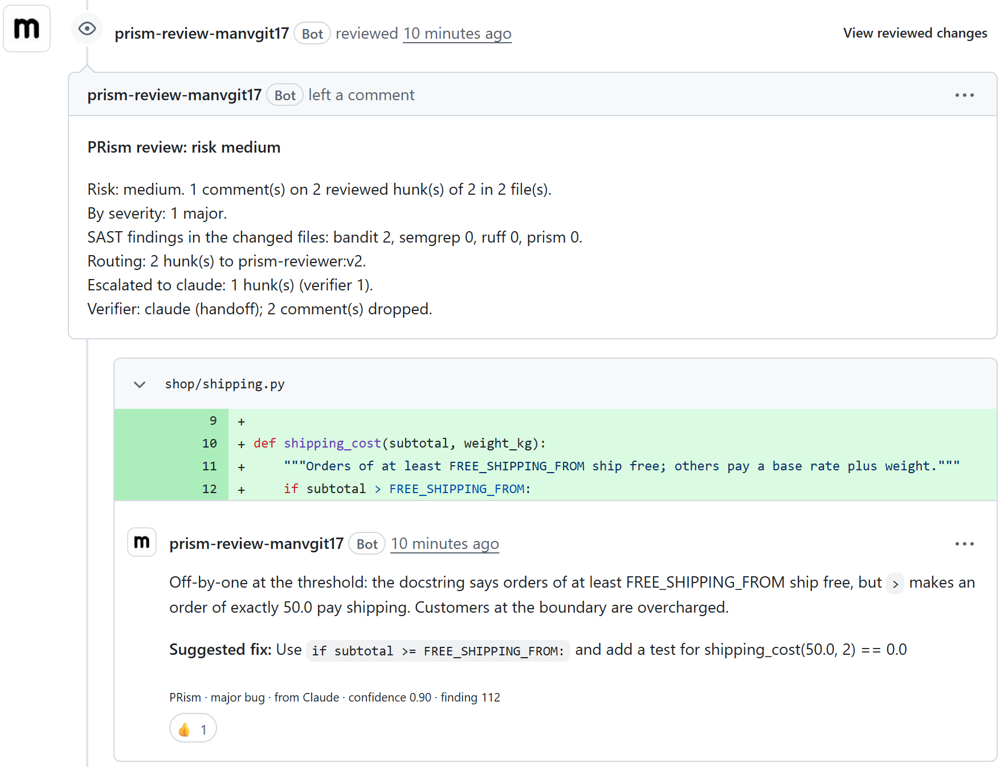
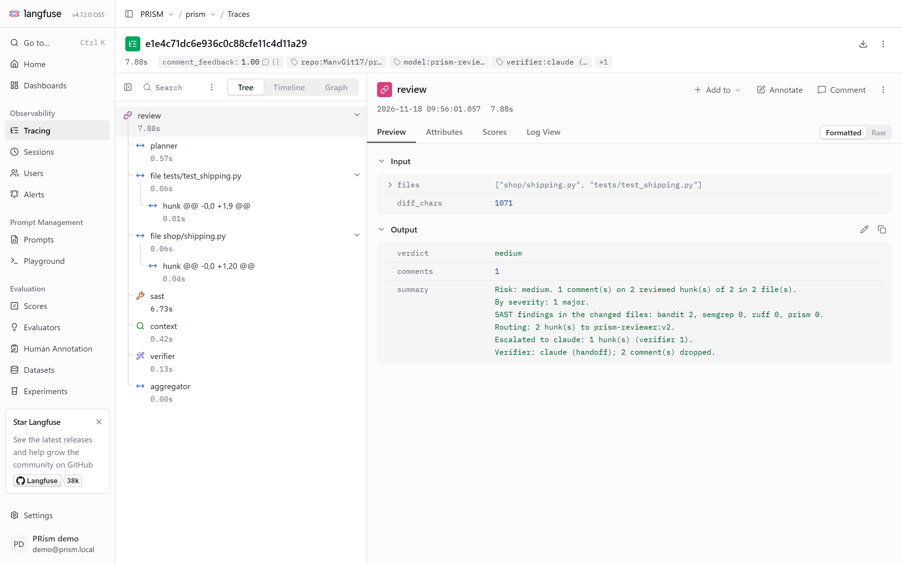

# Frequently asked questions

Short answers to what a new user or a reviewer of the project usually asks. Each answer links to the page with the detail.

## What is PRism?

A code reviewer that understands the repository a pull request lands in. It builds a code graph, retrieves the callers, callees and tests of each changed function, reviews every hunk with a small fine-tuned local model, runs static analysis next to it, and has Claude check every comment before it is posted. It runs as a CLI, as an MCP server for Claude Code, or as a GitHub App.

## Do I need an Anthropic API key?

No. Without a key the verifier is a handoff: the first `prism review` run writes requests and rubrics into the work directory and exits with code 2. A Claude session, or Claude Code through the MCP server, writes the answers, and the same command run again finishes with exit code 0 and prints the review JSON. With `ANTHROPIC_API_KEY`, the `frontier` group and `PRISM_VERIFIER=api` it runs in one go. See [Troubleshooting](troubleshooting.md#exit-code-2-from-prism-review) and [ADR 0011](../adr/0011-claude-verifier-handoff.md).

## Does my code leave my machine?

The local reviewer runs on your own Ollama. What goes to Claude is the hunk, the retrieved context and the tool findings, with secrets redacted first (known token formats, assigned secret values, and a detect-secrets pass), and the pull request text is treated as untrusted. Langfuse is self-hosted, and everything it receives is masked the same way. See [ADR 0013](../adr/0013-routing-redaction-injection.md).

## What do I need to run it?

Python 3.12 and `uv`, and Ollama on the host. `qwen2.5-coder:3b` works as the reviewer out of the box, and `nomic-embed-text` is needed for vector context. Docker is needed only for the persistent graph and vector stores (`make up`), the queue and Langfuse. This works without any service:

```bash
uv run prism review --repo PATH --diff FILE --store memory --mode graph
```

## Which model reviews my code?

The fine-tuned reviewer is Qwen2.5-Coder 3B, published on Hugging Face as `Maverick0824/prism-reviewer-3b` (GGUF and a Modelfile, Qwen Research License, non-commercial). The gate is `Maverick0824/prism-gate` (ONNX). The untuned `qwen2.5-coder:3b` scores the same on the judge I used and needs only `ollama pull`; set `PRISM_REVIEWER_MODEL` to choose.

## Why use a small local model if Claude checks everything?

The local model is a cheap first pass: it comments on most hunks at no API cost, and Claude then keeps, drops, relabels or moves each comment. Security-sensitive and very large hunks skip it and go straight to Claude. On BugBench, replacing the local model with Claude on every hunk changed little (49/57 against 48/57 planted bugs on the first 83 PRs), so the pipeline around the model matters more than which model writes the first comment. See [BugBench](../evaluation/bugbench.md).

## How good is it?

On BugBench, 198 real pull requests in four open-source projects, PRism found 115 of 139 planted bugs and 17 of 30 real bugs, and commented on none of the 29 clean PRs. A judge rated 162 of 167 posted comments true and useful. A PR-Agent comparison on the first 83 PRs found PR-Agent ahead on bugs found (54/57 planted against 48/57), with PRism posting half as many comments. The numbers, and what they do not show, are on the [BugBench](../evaluation/bugbench.md) page.

## What is BugBench?

A benchmark I built from real commits: 139 with a planted defect that a test catches, 30 that introduced a real bug fixed later (found with SZZ and checked by hand), and 29 clean ones. A bug is found when a posted comment sits within 3 lines of it. Run it with `make eval-bugbench`; see [Running BugBench](../evaluation/running-bugbench.md).

## Why is the confidence threshold 0.6?

`PRISM_VERIFIER_MIN_CONFIDENCE` decides which of Claude's comments are posted. At 0.6 PRism left every clean PR alone. At 0.4 it found 118 planted and 19 real bugs (against 115 and 17) at the cost of a comment on one clean PR, so I kept 0.6 and documented the trade ([ADR 0026](../adr/0026-threshold-sweep.md)).

## What languages does it understand?

Python and Java: the code graph is built with tree-sitter for both, and static analysis covers Bandit, Ruff and Semgrep for Python, Semgrep and PMD for Java. The benchmark has three Python projects and one Java project.

## What does the code graph add over reading the diff?

For each changed function PRism retrieves what calls it, what it calls, the tests that reach it and its enclosing class, plus similar code from vector search, then reranks and packs that into a token budget (1500 tokens per hunk by default). That is the context Claude sees when it judges a comment. See [ADR 0007](../adr/0007-retrieval-and-packing.md).

## What is the gate?

A CodeBERT classifier exported to ONNX that scores each hunk for whether it would get a review comment. Hunks it scores low are not reviewed, which saves model time. On BugBench's first 83 PRs it skipped 29% of hunks and cost 2 of 57 planted bugs ([ADR 0024](../adr/0024-ablation-gate.md)). The default setting is `PRISM_GATE=pass-all`, which lets every hunk through until a gate model is in `PRISM_GATE_MODEL_DIR`.

## How do I use it from Claude Code?

Install the `mcp` and `sast` groups and register the server:

```bash
uv sync --group mcp --group sast
claude mcp add prism -- uv run --directory /path/to/prism --group mcp --group sast prism mcp
```

Then ask Claude Code to review your uncommitted changes. `review_diff` reviews `git diff HEAD`, and when verification is needed Claude Code answers it with `submit_answers` and asks again. See [ADR 0016](../adr/0016-mcp-review-tools.md).

## What does a review look like on GitHub?

The App posts one `COMMENT` review (never an approval or a change request) with a summary and inline comments. Each comment ends with a footer such as "PRism · major bug · from Claude · confidence 0.90 · finding 112".



See [ADR 0017](../adr/0017-github-app.md).

## Why does the App not post right away?

With the handoff verifier, a review is held until Claude has answered its verification requests, because the local model's unverified comments are not fit to post. With `PRISM_VERIFIER=api` it posts as soon as the review finishes. See [Troubleshooting](troubleshooting.md#the-review-was-received-but-nothing-was-posted).

## Does it learn from feedback?

It collects it. Reactions, replies and resolved threads on PRism's comments become Langfuse scores (`comment_feedback`) and items of the `prism-comment-feedback` dataset. `prism app feedback-report` shows how useful the comments were by author, category and confidence, and `prism app feedback-export` writes JSONL plus preference pairs for a later training round. Nothing retrains the model automatically. See [ADR 0019](../adr/0019-comment-feedback.md).

## Where do I see what happened in a review?

In Langfuse, which holds one trace per review with a span per file and hunk (`make langfuse-up`, then http://localhost:3001), and in the dashboard (`prism dashboard`, port 8090), which shows reviews, comments posted and dropped with the verifier's reasons, routing and the eval reports. In Claude Code, `explain_finding` says why a comment was posted or dropped.



## How much memory does it need?

The core services (Postgres, Neo4j, Redis) use about 0.95 GiB at rest, the Langfuse profile adds about 1.9 GiB, and `qwen2.5-coder:3b` on the host about 2.2 GB. The figures and limits are in the [memory budget](../memory-budget.md).

## Is it licensed for commercial use?

The code is Apache 2.0. The fine-tuned reviewer weights follow the Qwen Research License, which is non-commercial; the base model's licence applies to anything built on it. Check the licence of each model you use.
